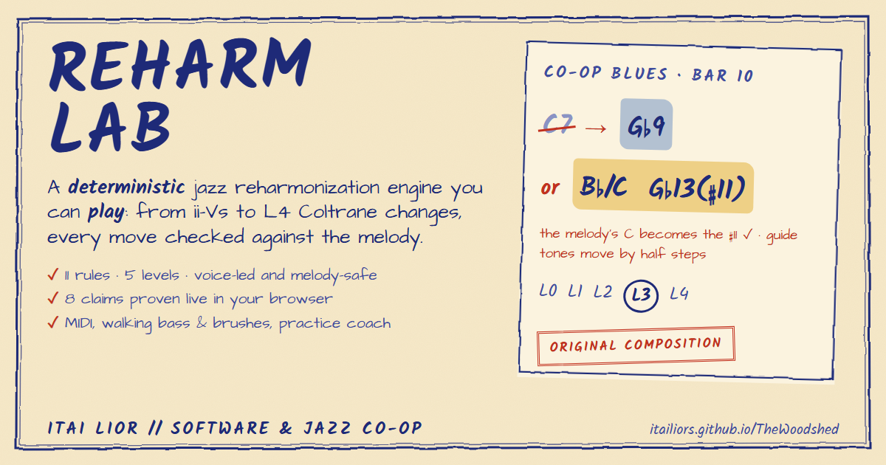

# Reharm Lab

[](https://itailiors.github.io/TheWoodshed/)
[](https://github.com/itailiors/TheWoodshed/actions/workflows/ci.yml)

**A living lead sheet for jazz pianists: reharmonize a standard, hear every move, and practice it until it's yours.**

### ▶ [Try it in your browser](https://itailiors.github.io/TheWoodshed/)

No install, no account, no MIDI keyboard needed (press **M** to play with your computer keyboard). Press **Play**, then turn the dial from **L0** to **L4** while the band plays.

*A flagship project of **ITAI LIOR // SOFTWARE & JAZZ CO-OP**.*

<!--
  DEMO GIF: record about 20 seconds (dial L0 → L4 while the band plays, a move card, the X-ray's
  Proof tab going green), save it as docs/media/demo.gif (under ~8 MB so GitHub autoplays it),
  then replace the image below with:
  [](https://itailiors.github.io/TheWoodshed/)
-->
[](https://itailiors.github.io/TheWoodshed/)

---

## Mission

Advanced jazz harmony is usually learned in fragments: a tritone sub from one record, a gospel turnaround from another, a voicing from a teacher's hands. Reharm Lab brings that vocabulary into one place, built around a real tune.

Load a tune (it opens on *Co-op Blues*, an original 12-bar bebop blues in F written for the app) and the app:

1. **Suggests reharmonizations** bar by bar, from functional ii–Vs to tritone substitutions, upper-structure voicings and gospel turnarounds.
2. **Explains why each move works**: function, voice leading, melody compatibility and a one-line rule you can carry to any tune.
3. **Maps the right hand**: the scales that fit every chord, original or reharmonized, with the guide tones to land on.
4. **Makes you play it**: a MIDI comping coach marks your voicings in red pen, an improv heatmap scores your lines, and a 12-key drill moves everything to a new key so you learn the function, not the finger shape.

The goal isn't a chord-substitution generator. It's a practice partner that teaches you to make these moves on the fly.

---

## Architecture: two halves, one source of truth

```
┌──────────────────────────── packages/theory-core ────────────────────────────┐
│  DETERMINISTIC THEORY ENGINE (pure TypeScript, no UI, no network)            │
│                                                                              │
│  spelled pitches → chord analysis → reharm rules → melody filter → scoring   │
│        → pathways → voicings (min. voice movement) → scale mapping           │
│        → practice evaluation (strike diff, voice-leading diff, line eval)    │
└──────────────┬─────────────────────────────────────────────┬─────────────────┘
               │ same functions, in the browser              │ same functions, on the server
┌──────────────▼───────────────────────────┐   ┌─────────────▼──────────────────────────┐
│ apps/web: PRACTICE TOOLS & UI            │   │ apps/api: Hono proxy                   │
│ React · Vite · Rough.js · Tone.js · MIDI │   │ recomputes the move → computed facts   │
│ living lead sheet, reharm dial,          │◄──┤ → Claude → { summary, deepDive,        │
│ A/B playback, coach, heatmap             │   │   recreateRule }, cached on disk       │
└──────────────────────────────────────────┘   └────────────────────────────────────────┘
```

**The theory engine is deterministic and decides every pitch.** It spells notes the way a chart would (D7(♯5) contains A♯, not B♭), so its explanations are correct as well as playable. It runs in the browser, so turning the reharm dial, flipping A/B or transposing to a new key recomputes instantly.

**The UI is where you practice.** It treats the engine as a library: the lead sheet, the playback arranger, the comping coach and the heatmap all call the same pure functions.

**The language model never chooses notes.** The Deep Dive API sends Claude only the engine's computed facts and asks it to turn them into teaching prose, under a system prompt that forbids inventing pitches, melodies or recordings.

---

## Features

### 🎚️ Reharm Dial with A/B ghost playback
- A five-level "spice dial" (Original → Functional → Bebop → Gospel → Modern) controls how adventurous the moves are *and* how many there are, phrase by phrase:

  | Level | Moves allowed |
  |---|---|
  | L1 | 1 per 8 bars |
  | L2 | 1 per 4-bar phrase |
  | L3 | 2 per 4-bar phrase |
  | L4 | no limit |

  In each phrase, the best moves win: higher level first, then smoother voice leading, then variety (it avoids repeating a rule it has already used). Moves you pick by hand count toward the same limit.
- Moves show on the lead sheet as watercolour washes, coloured by category. Click one to open its card; swap in any alternative that fits the same bars.
- **Playback:** a Tone.js arrangement in the tune's feel (swing, waltz, bossa, ballad) on a sampled grand piano (Salamander), with a synth fallback: voice-led comping with the melody on top, over the backing band below.
- **Voice-led voicings:** each chord is voiced in the inversion that moves least from the previous one, so you hear the half-step motion the engine describes (Fm9 → B♭7(♭9) → E♭maj7 plays as 60 63 67 68 → 59 62 65 68 → 58 62 65 67).
- **Ghost A/B:** flip Original/Reharm or turn the dial *while it plays*. The new chords take over on the next beat. Loop just the selected move, change the tempo, and follow the pencil playhead.
- **🦶 The dial under your foot:** click **Link to mod wheel / pedal** and an expression pedal (MIDI CC 11) or mod wheel (CC 1) drives the dial while the band plays: heel down is the original changes, toe down is L4. A red ink needle under the dial follows the controller continuously, and the pen circle snaps from stop to stop, so you can see where your foot is and which harmony you're hearing.
  - It's opt-in, so a jittery wheel can't change the harmony on its own. Whichever controller moved last is in charge.
  - The mapping (`pedalToLevel` in `theory-core`) has hysteresis: to leave a level the value has to travel 6 units past the band edge. Property tests guarantee that 0 is always L0 and 127 always L4, that a slow sweep visits every level once in order, and that jitter inside any 12-unit window changes the level at most once.
  - Unlike a click on the dial, the pedal keeps your hand-picked moves and the selected move.
  - Every Control Change travels on a `controlBus`, the twin of the note bus, so later controller features (MIDI learn, a foot switch) plug in the same way.

### 🧠 The rule library
Eleven deterministic rules. Each works in intervals relative to its local target, so it applies in all 12 keys and to tonicized chords:

| Level | Rules |
|---|---|
| L1–L2 | Secondary / related ii–V · tritone substitution · upper-structure triad · passing diminished (♯I°7 as a rootless V7♭9; chromatic ♭iii°7) |
| L3 | Gospel half-step turnaround · backdoor ii–V (iv–♭VII7) · ♭VI–♭VII–I · borrowed iv (minor plagal) · common-tone diminished |
| L4 | Coltrane substitution (three key centres a major 3rd apart) · constant structure (the target's shape planed down by half steps) |

Every move goes through the same melody filter and voice-leading score, and comes with its own explanation and a key-independent rule.

### ⌨️ No MIDI? Play the computer keyboard
- Press **M** (or the ⌨ pill in the transport) and the computer keyboard becomes a piano, in the layout DAW users already know: `A S D F G H J K L ; '` are the white keys from C, `W E · T Y U · O P` the black keys, `Z` / `X` shift the octave.
- Keys are matched by physical position (`KeyboardEvent.code`), so the shape is the same on AZERTY and QWERTZ.
- Notes go out on the same note bus as MIDI, so the heatmap, the Coach and every other tool treat them exactly like a real keyboard, and they sound through the app's piano.
- Held keys are released if the window loses focus or the tab is hidden, and a key released after an octave shift still lets go of the pitch it started.
- While it's on, the letter keys belong to the piano: Practice Mode's `A` and `L` shortcuts pause, and its shortcut legend hides them.
- Laptop keyboards register only a few keys at once, so this suits single-note lines best; for full Coach voicings, click the on-screen keys.

### 🔊 Hear your MIDI keyboard
- Connect a MIDI keyboard and what you play sounds through the app's piano, with your velocity and the sustain pedal. Most USB controllers have no speakers, so this is on by default.
- If your keyboard has its own sound, switch the **🔊 Hear it in the app** pill (next to the MIDI pill) to **🔇 Keyboard speakers only**. The choice is remembered.
- Clicking **Connect MIDI** also warms up the audio engine, because a MIDI message isn't a user gesture and can't unlock browser audio itself. So the first note you play already sounds.

### 🎹 MIDI Comping Coach
- **Its own page:** a third mode next to Study and Practice. Open it from the mode switch, a move card's **Drill the voicing**, the sidebar, or the passport.
  - **Left:** what to drill. The moves in your reharm, every other move the engine found in the tune (including ones the dial isn't showing), and the reviews that are due.
  - **Centre:** the drill.
  - **Right:** this concept's 12-key passport page. Keys are stamped as you play them clean, the key you're drilling is ringed, and clicking a key drills it there.
- Asks you to play the move (e.g. *Fm9 → B♭7(♭9) → E♭maj7*) and listens to your keyboard through the Web MIDI API. Without a keyboard, click keys on screen or play the computer keyboard (see *No MIDI? Play the computer keyboard* below).
- **Strike diffing:** each chord you play is compared with the engine's reference voicing. It catches missing guide tones, wrong notes (and names avoid-note clashes), and accepts rootless voicings and other inversions.
- **Voice-leading diffing:** between chords it pairs your right-hand voices and checks that each moves by step, comparing your total movement with the engine's.
- **Teacher's red pen:** hand-drawn circles where a 3rd or 7th should be, crosses on wrong notes, a big checkmark for a clean, smooth strike, and written comments in the margin.
- **12-key transfer drill:** jump to a random key, or move to a new one automatically after every clean run. The engine re-spells every chord and voicing; the hint can be hidden so you work from function.
- **Self-check at an acoustic piano (no cable):** on a phone or iPad (and anywhere you pick ✋ *Self-check*) the Coach stops waiting for input. Play each chord from memory, tap **Show the voicing** to see the engine's voicing and how each voice moved, then grade yourself: **I played it perfectly** or **I missed it**. Self-checked runs go through the same SM-2 grading and review queue, and are stored as `graded_by = self`, since nobody heard the notes and voice-leading leaps can't be measured. Plugging in MIDI switches back to listening. The drill only deals in per-chord verdicts, so microphone pitch detection can be added later as another way of listening.

### 📱 Phones and tablets
- **Phone layout:** the lead sheet draws two bars a line instead of scrolling sideways, and the heatmap pages four bars at a time. Transport, band and key controls fold behind one toggle. In the Coach, the drill comes before the move list, with a voicing keyboard zoomed to the octaves the move uses.
- **Touch:** pill buttons and checkbox labels grow to 44px on touch screens. Taps skip the double-tap-zoom delay. Heatmap notes explain themselves on tap, since touch has no hover. Controls that can't work are hidden: there's no QWERTY toggle without a keyboard, and no MIDI button on iPhone or iPad Safari, which has no Web MIDI.
- **Wake lock:** the screen stays on while the band plays and during a Coach drill, so a phone on the music stand doesn't lock mid-chorus.
- **iPad upright:** in Practice mode the lead sheet sits above the chord HUD rather than squeezed beside it.

### 🔥 Improv Heatmap
- Solo over the backing loop. Every note is captured with its position in the loop and judged against the chord sounding at that moment:
  **blue** chord tone · **gold** tension · **red** avoid note · **faint** chromatic/outside.
- Short off-beat avoid notes are shown as passing tones rather than mistakes. Guide tones landed on a chord change are outlined.
- Notes are drawn on a "loop tape" whose older passes fade, with stats for chord tones on the beat, guide-tone landings and held avoid notes.

### 🥁 Trio mixer: a built-in backing band
- Three ink-doodle toggles (piano, upright bass, snare with brushes) sit next to Play in both modes. A muted instrument fades to pencil grey under a red-pen slash. In Practice Mode, keys `1` `2` `3` toggle them, and the mix is remembered.
- **Bass**, generated in `theory-core` from the tune's feel:
  - swing and jazz waltz get a **walking line**: the root on each downbeat, chord tones in between (the smoothest of every candidate line wins) and a chromatic approach a half step into the next chord;
  - the walk is then humanized: it leans on 2 and 4 (on 1 in a waltz), sometimes approaches a change with an eighth-note **triplet pickup** (a ghosted rake, then a two-step chromatic run), and sometimes **drops a beat**, letting the previous note ring. The variations are seeded per tune, so the line repeats as written;
  - ballad, bossa and straight eighths get a **two-feel**: root on 1, the 5th on 3.
- **Drums**:
  - a ride playing "ding, ding-a-ding": quarter notes full, the swung skip note ghosted;
  - a strongly accented foot chick on 2 and 4 (2 and 3 in a waltz);
  - occasional ghosted snare notes on the triplet partials;
  - a feathered kick and a quiet brush-sweep texture.
- **Real samples, with fallbacks**:
  - the upright is the General MIDI acoustic bass from [midi-js-soundfonts](https://github.com/gleitz/midi-js-soundfonts) (MusyngKite, then FluidR3, then FatBoy);
  - the kit is a GM kit from [WebAudioFont](https://github.com/surikov/webaudiofontdata) (FluidR3, then JCLive, then SB Live): kick, snare, ride, closed and pedal hi-hat. The app fetches each file as text and decodes only its embedded MP3, never running the file's script;
  - if every source fails, the old synths take over, so Play always works, and the transport bar says so;
  - check each soundfont's licence before any commercial use.
- **Micro-timing**: every bass and drum strike is pushed or dragged by up to ±15 ms, on a triangular spread so most land close to the grid, and its velocity varies slightly. Both change on every pass of the loop.
- While the bass player is in, the app's piano drops its left-hand bass and comps rootless. Mute the bass and the left hand comes back. Mute the piano and you're comping with a bass-and-drums duo.

### ⏱️ Time you can see, in any key
- **Count-in:**
  - 0, 1 or 2 bars of side-stick before the band comes in, shown as a big "1 · 2 · 3" over Practice Mode's HUD;
  - it runs on the audio clock, and the Transport is set to start exactly where it ends;
  - Space during the count-in cancels it cleanly.
- **Click:** a fourth mixer instrument (a metronome doodle), off by default. Dry woodblocks, high on the downbeat and low on the others, dead on the grid while the band swings around it. Key `4` in Practice Mode.
- **Metronome dot:** an ink blot in the margin lands on every beat, red on the downbeat, beside a row of beat dots that shows where you are in the bar.
- **Global key change:** a hand-drawn circle of fifths (or the ♭/♯ half-step buttons, or `,` `.` in Practice Mode) moves the whole tune: chords, melody, every reharm move, the scale map, playback and the Deep Dive, which is written about the key you're in. Each tune remembers the key you last played it in. Move ids are positional, so your picks and loop survive the key change.
- **Study ↔ Practice continuity:**
  - the band keeps playing across the switch;
  - with the View Transitions API, the lead sheet and title glide from one layout to the other while the rest cross-fades (skipped under reduced motion, and never allowed to hold up the switch);
  - **Practice this move** jumps straight into Practice Mode looping that move, counting in if the band wasn't already playing. If it was, the playhead jumps into the new loop at once;
  - **Drill the voicing** opens the Comping Coach page on that move.

### ✍️ Claude-powered Deep Dive
- One click turns a move into a short lesson: a summary, a 150–260-word deep dive (function, voice leading, how to hear and play it) and a key-independent rule.
- The server recomputes the move itself and sends Claude only the computed facts. Structured outputs keep the response in the `{ summary, deepDive, recreateRule }` shape.
- The system prompt sets the voice (analytical and encouraging, written for a pianist studying Bill Evans and Shaun Martin vocabulary) and the rules: no invented notes, keep the engine's spelling, flag missing melody data.
- Results are cached on disk by a hash of prompt version, model and facts, so each move is paid for once.

### 📚 Setlist: iReal Pro import + local library
- Paste an `irealb://` (or older `irealbook://`) link, for one song or a whole playlist. The importer:
  - de-obfuscates the chart;
  - unrolls `{ }` repeats with first and second endings, `x`/`r` bar repeats, slash chords and N.C.;
  - maps iReal chord qualities (`^7`, `-7b5`, `h7`, `7alt`, `9sus` …) onto the engine's spelled chords;
  - adds Roman-numeral analysis.
- Playlists become setlists. Re-importing a song updates it in place, and anything the importer had to approximate (road-map directions, odd chord symbols) is reported as a note on the tune.
- Tunes are stored in SQLite through Drizzle ORM. The library drawer lets you search, filter by setlist, load a tune and delete it. The app remembers the last tune you loaded.

### 📒 Concept passport: practice history with a memory
- **Every run is kept.**
  - Each finished Comping Coach run is saved with its rule, move and key. The server grades it 0–5 from your misses and voice-leading leaps and reschedules that concept in that key (spaced repetition: a miss comes back in 10 minutes, clean runs after 1 day, then 3, then further apart). The Coach then tells you what it decided ("graded 5/5 in B♭ · next review tomorrow"). Its "Clean in" list draws on every past session, not just this one.
  - The Improv Heatmap saves a summary of each pass over the loop, when the loop wraps, when you stop, or when you leave mid-pass: chord tones, tensions, avoid notes, chord tones on the beat, guide-tone landings and held avoid notes. Passes of fewer than 4 notes are skipped.
- **The passport** (📒 in the sidebar or toolbar):
  - **Today's practice:** the review queue as a teacher's clipboard. Each item says what's due and how overdue, and **Practise →** opens the Comping Coach page on that exact move, in that key, loading the chart you last practised it on if needed.
  - **Passport pages:** one per concept, the 12 keys round the circle of fifths. Keys you've played clean get an ink wash and a red CLEAN stamp, keys you've tried show your last grade, untouched keys stay faint outlines. Click any key to practise it there.
  - **Recent solos:** an ink sparkline of chord-tone accuracy per pass, with guide-tone landings as dots.
- History belongs to the chart: a transposed tune (`coop-blues@Db`) is recorded against the chart itself. Sessions open on your first saved run and close when you leave the page. If the API is down, a single note says runs aren't being saved, and practice carries on.
- **In the read-only demo** nothing is saved, so the passport opens on a clearly labelled **sample notebook**: three weeks of a made-up player's practice (33 key reviews scheduled by the same SM-2 rules as the API, 5 of them due, and 20 solo passes improving from 45% to 75% chord tones). Times are stored relative to page load, so the demo never drifts into "everything overdue". Your own runs stamp on top of it until you reload.

### 🔬 Engine X-ray: watch it decide, then watch it prove itself
- **How it decided:** pick a bar (or let it follow the playhead) and read the engine's reasoning as a four-stage pipeline:
  1. **The rule proposes:** every move that touches the bar, with its level and chords. The rules that had nothing to say are listed too.
  2. **The melody filter:** struck-out proposals get a red-pen line and the reason ("B♭ is the 11 of Fmaj7, a half step above the 3rd (A)").
  3. **Voice leading:** the guide-tone score as a hatched ink bar, with the actual motion (A♭→G, −1).
  4. **The pathway:** the verdict and the arithmetic behind it (`L2×2 + 9 = 13`): in the reharm, lost the beats to a better move, phrase quota full, or too spicy for the dial.
- **It can't misrepresent the engine.** `generateMoves` and `buildPathway` are thin wrappers over `generateMovesTraced` and `buildPathwayTraced`, so the X-ray reads the same code path the app plays from, and a property test checks that.
- **Proof:** the engine's claims run live in the browser. That's 8 properties × 200 generated tunes in a Web Worker: deterministic, melody-safe, keeps the form, respects the dial, the X-ray tells the truth, key-independent, spells like a chart, walks like a bassist. They're the same `PROOFS` objects CI asserts (`@reharm/theory-core/testing`).
  - Re-run a seed to replay identical cases.
  - A failure shows fast-check's shrunk counterexample.
  - A determinism handshake hashes the engine's full output (SHA-256) on the main thread and in the worker, and shows they match.
- Lazy-loaded: the X-ray is an 18 kB chunk, and fast-check exists only inside the worker. It works in the static demo too, with no API.

### 🧯 Fails gracefully, loads fast
- **API down or offline:** a red-pen banner says exactly what's paused (setlist, import, deep dives) and what still works (everything musical, since it all runs in the browser), with a Retry button. One shared health check drives it, and it clears as soon as the API is back.
- **No Claude key:** Deep Dive doesn't error. It says the engine's own explanation on the card is the full analysis, and how to switch Claude on. The API marks the case with a machine-readable code (`no_key`).
- **A deleted tune:** if the remembered tune is gone, a toast names it and *Co-op Blues* goes back on the stand. If the API is only down, the remembered tune loads as soon as the API returns. Deleting the open tune steps off it at once.
- **Mobile audio:** iOS plays Web Audio on the channel the silent switch mutes. The app declares itself a music app (`navigator.audioSession.type = "playback"`) and, on older iOS, starts a looping silent `<audio>` element on your first tap, which moves the page onto the media channel. Every tap or key press also wakes an audio context the OS suspended (after a call, an app switch or a background tab).
- **Live notes play now:** keys you press sound on the raw audio clock (`Tone.immediate()`), not `Tone.now()`, which adds the 100 ms look-ahead meant for the scheduled band.
- **No stuck notes:** held notes are tracked per MIDI device. Unplug a keyboard mid-chord (or hit its All Notes Off button) and its keys are released through the note bus as if they'd come up, so the Coach doesn't grade the next chord with phantom notes, and a toast says what happened. Per-note MIDI logging runs only in development, so the public console stays clean.
- **Loading the band:** a sketched ink line fills as the piano, bass and drums arrive, with a red "~" on any instrument that fell back to a synth.
- **Code-split:**
  - Tone.js and the band are a 271 kB engine chunk loaded on demand and prefetched when the browser is idle, so the first Play still counts as a user gesture;
  - Rough.js, the library drawer, the Coach and Practice Mode each have their own chunk;
  - React has a long-cached vendor chunk;
  - the critical path dropped from 631 kB to 92 kB of app code plus 223 kB of React (187 kB → 102 kB gzipped).

---

## Tech stack

| Layer | Tools |
|---|---|
| Theory engine | TypeScript, no runtime dependencies (`packages/theory-core`) |
| UI | React 19, Vite, Tailwind CSS v4 |
| "Living lead sheet" design | **Rough.js** (seeded hand-drawn shapes), SVG turbulence / displacement filters (ink wobble, watercolour washes), Google Fonts *Kalam*, *Architects Daughter* and *Noto Music* |
| Audio | **Tone.js** (Transport, Part, Sampler): Salamander Grand Piano, GM acoustic bass (midi-js-soundfonts) and a GM drum kit (WebAudioFont), with synth fallbacks |
| Input | **Web MIDI API** (hot-plug aware, stuck-note safe), the computer keyboard and on-screen keys, all on one shared note bus |
| API | **Hono** on Node, **Anthropic SDK** (Claude, structured outputs, prompt caching) |
| Storage | **SQLite** via **Drizzle ORM** on **sql.js** (WebAssembly: no native build), committed migrations, atomic writes to `apps/api/data/reharm.sqlite` |
| Testing | **Vitest** + **fast-check** (property-based testing) |
| Tooling | npm workspaces monorepo, `tsx`, `concurrently` |

---

## Testing: property-based by design

Music theory has invariants, so the engine is tested against them rather than against a handful of examples. [fast-check](https://fast-check.dev) generates thousands of random ii–V–I progressions in every key, in 3/4 and 4/4, with and without melodies, and checks that:

**Spelling**
- Transposing any spelled note by any interval preserves both the letter distance and the semitone distance (so D + ♯5 = A♯, never B♭).
- MIDI ↔ spelled-pitch conversion round-trips, including C♭ and B♯.

**Reharmonization rules**
- Every move keeps its span exactly, and its chords are laid out back to back.
- Accepted moves never put an avoid note under the melody, and every rejected move gives a reason.
- Tritone subs share the original dominant's 3rd/♭7 tritone and resolve by a half step in the bass.
- Secondary ii–Vs sit a perfect 5th above their target, twice.
- Upper-structure triads sit on the ♭13 and contain only chord tones.
- In the gospel turnaround, no voice moves more than a half step into the tonic.
- Pathways never overlap and respect the dial level.

**Scales and voicings**
- Every suggested scale contains every chord tone and every melody note.
- Voicings always include the guide tones, keep the root in the bass, stay in playable ranges and use only chord or standard colour tones.

**Practice tools**
- The engine's own voicing is always judged "perfect"; removing a guide tone is always flagged, with the right place for the red pen.
- Transposing a tune to any of the 12 keys yields exactly the same moves, shifted.
- Line evaluation never mislabels a chord tone, and every note gets a readable role.
- The walking bass plays every beat in range, lands each chord's root on its downbeat and approaches the next root by a half step; the two-feel is always root on 1, fifth on 3; the ride, hi-hat and brush patterns stay in time and inside the form.

Two **golden tests** pin the engine to real tunes:
- **Co-op Blues**, the reference tune. Its head was written so the dial tells a story: nothing at L0, one move at L1, then 3, 4 and 12. Six different rules are accepted, and the head's own notes reject other moves for reasons you can hear (a plain A over D7 rules out the ♭13 upper structure; the D in bar 4 is the ♯9 of the tritone sub).
- **Someday My Prince Will Come** (bars 1–8), the engine's original design simulation, so its moves, melody-based rejections, pathways and scale map stay exact. It lives only in the test suite and is no longer shipped in the app.

The headline claims also live in `src/testing/proofs.ts` as plain `Proof` objects (a sentence, plus a fast-check property). CI asserts every one, and the app's **Proof** tab runs the very same objects live in the browser, so the evidence a visitor sees is literally the test suite.

Each of the advanced rules has its own invariant, checked on random diatonic progressions in every key: the backdoor ♭7 falls to the tonic's 5th, ascending passing °7s equal a rootless V7♭9 of the target, Coltrane's key centres form an augmented triad with each dominant resolving down a 5th, and constant-structure chords keep the target's exact shape.

The **API suite** runs the server in-process against throwaway databases. It covers:
- iReal import and setlists;
- payload validation;
- practice history and the review scheduler (also property-tested);
- demo mode, which is shown to refuse every write and never call Anthropic.

A setup file points the default database path at a sentinel, so tests can never write to your real library.

```bash
npm test          # 133 tests (engine + API), several thousand generated cases
npm run typecheck # all three workspaces
```

**CI** ([`.github/workflows/ci.yml`](.github/workflows/ci.yml)) runs on every push:
1. typecheck;
2. both test suites;
3. a check that the SQL migrations match the Drizzle schema;
4. the web build;
5. the demo build, uploaded as an artifact;
6. on `main` only, once all of the above pass: the demo is published to **GitHub Pages** at [itailiors.github.io/TheWoodshed](https://itailiors.github.io/TheWoodshed/).

---

## Getting started

**Requirements:** Node 22+ (the API uses Node's built-in `.env` loader).

```bash
npm install
cp apps/api/.env.example apps/api/.env   # then add your ANTHROPIC_API_KEY
npm run dev                              # web on :5173, API on :8787
```

| Variable (`apps/api/.env`) | Required | Default |
|---|---|---|
| `ANTHROPIC_API_KEY` | for Deep Dive | – |
| `EXPLAIN_MODEL` | no | `claude-opus-5-5` |
| `PORT` | no | `8787` (Vite forwards `/api` here) |

Other scripts: `npm run dev:web` (UI only), `npm run dev:api` (API only), `npm test`, `npm run typecheck`.

### Read-only demo (for the portfolio)

| Command | What it gives you |
|---|---|
| `npm run build:demo` | A **static** site in `apps/web/dist-demo` that can be hosted anywhere (relative paths), with no server and no API key. CI publishes it to [GitHub Pages](https://itailiors.github.io/TheWoodshed/) on every push to `main` |
| `npm run dev:demo` | The same, locally |
| API with `DEMO_MODE=true` (or `--demo`) | For a hosted server: no database, every write refused (403) |

In both forms, the demo:
- opens on *Co-op Blues* and has a small **demo library** in the Setlist drawer: Co-op Blues plus two public-domain standards, *On the Sunny Side of the Street* and *I Got Rhythm* (both published 1930), as chord changes only. There's no import or delete in the demo;
- opens the Concept Passport on a labelled sample notebook (`apps/web/src/library/demoHistory.json`, regenerated with `npx tsx apps/web/scripts/gen-demo-history.ts apps/web/src/library/demoHistory.json`, which refuses to write if any passport entry points at a move the engine doesn't accept on the reference tune);
- serves Deep Dives from `apps/api/demo/explanations.json`, so visitors never trigger an Anthropic call.

The shipped file holds the engine's own text. To replace it with Claude-written Deep Dives, run this once with your key:

```bash
npm run demo:generate -w @reharm/api
```

It uses the explanation cache, so re-runs only pay for new moves. Add `-- --template` to rebuild it from engine text without the API. Re-run it whenever the rules change; a test fails if any demo move is missing from the file.

### Practice history

`practice_sessions`, `coach_attempts`, `improv_runs` and `concept_reviews` record:
- coach runs per concept and key (the "clean in" keys);
- heatmap summaries;
- a spaced-repetition schedule (SM-2 style) per concept per key.

Endpoints are under `/api/practice`: `sessions`, `coach-attempts`, `improv-runs`, `progress`, `due`.

A MIDI keyboard is optional: every practice tool also takes clicks on the on-screen keys and the computer keyboard (press `M`). Web MIDI works in Chromium-based browsers (Chrome, Edge); Safari has none, and Firefox asks for a site permission.

---

## Project layout

```
packages/theory-core/   deterministic engine
  src/pitch.ts            spelled pitches, intervals, MIDI
  src/chords.ts           chord tones, guide tones, symbols
  src/rules.ts            the reharm rules (ii–V, tritone sub, upper structure, gospel turnaround)
  src/engine.ts           generate → melody filter → score
  src/pathway.ts          dial levels, non-overlapping pathways, realization
  src/scales.ts           right-hand scale mapping
  src/voicing.ts          minimum-movement voicing engine
  src/coach.ts            drill steps, strike diff, voice-leading diff
  src/lineEval.ts         improv note evaluation
  src/transpose.ts        12-key transfer
  src/import/ireal.ts     iReal Pro link parser
  src/analysis.ts         Roman-numeral analysis
  test/                   property-based + golden tests
apps/web/               React app
  src/design/             Rough.js primitives, tokens, SVG filters
  src/components/         lead sheet, move cards, transport, practice tools
  src/audio/              Tone.js arranger and player
  src/midi/               Web MIDI hook, note bus, chord-strike detection
apps/api/               Hono server: library, iReal import, moves, Claude Deep Dive
  src/db/                 Drizzle schema, sql.js client, repository
  drizzle/                SQL migrations (npm run db:generate -w @reharm/api)
```

---

## Roadmap

**Next up**
- Deploy the static demo, with a CI badge here, link-preview (OG) tags and a short GIF of the dial under the pedal.
- Deep-link URLs (`?level=3&key=Bb&play=1`) that open the demo mid-groove.

**Done for launch:** *Co-op Blues* replaced *Someday My Prince Will Come* as the reference and demo tune, so the public demo ships no copyrighted melody; the expression pedal drives the dial.

**Later**
- Drag across bars to loop them (A–B loop).
- Melody capture from MIDI, so imported tunes get the melody check.
- MusicXML import (melody included, so moves can be melody-checked).
- Arrangement builder: chain pathways chorus by chorus and export MIDI or MusicXML.
- Shareable reharm links: the engine is deterministic, so a URL can carry the whole reharm.
- Heatmap analytics across sessions.

### Future Roadmap: The Musician's Wishlist

Ideas from the bandstand rather than the backlog: what would make a gigging jazz pianist want to open this every day.

**🦶 Expression Pedal: the harmony under your foot** *(built: see the Reharm Dial above)*
Map an expression pedal (MIDI CC 11), a foot controller (CC 4) or the mod wheel (CC 1) to the reharm dial, with MIDI learn. Heel down is the original changes; toe down is L4 Coltrane territory. The dial is the app's best idea, but today it lives under the mouse. Under the foot it becomes something you *perform*: you decide, live, how far outside the band goes, and the chords swap in on the next beat. A little hysteresis keeps a resting foot from flickering between levels.

**🥁 Reactive Rhythm Section: a band that listens**
Right now the band plays *at* you. A real rhythm section plays *with* you. Comp on the and-of-4 and the drummer catches it with the kick; lay out and the bass drops into a two-feel; dig in and the ride opens up, while a soft passage brings out the brushes. Your velocity and rhythmic placement, already on the note bus, steer the seeded drum and bass generators. This is the difference between a play-along and a trio.

**🎤 Inner Voice Singing: hear the line inside the chords**
Every reharm hides a beautiful chromatic line in the tenor voice. The app plays the reharm with one inner voice brought forward as a melody, then drops that voice and asks you to sing it (pitch detection on the microphone) or play it. A guide-tones-only variant has you fill in the rest. Players who hear inner voices comp like orchestrators, and the voice-leading engine already knows every line.

**🎺 Gig Mode: the bandstand, not the practice room**
The app calls the tune: a random key, a random tempo, a two-bar count-off that won't wait. Halfway through, "the singer wants it in A". You cue the last chorus and the tag from the keyboard. Practice rooms train recall; bandstands train recall under pressure, which is what gigging players actually lack. It reuses the global key change, the count-in and the review queue.

**🕵️ Harmony Catcher: get credit for what you play by accident**
While you comp or improvise freely, the engine listens for its own moves in your playing. Play a backdoor ii–V in E♭ without being asked, and it stamps your passport: *"You just played a backdoor ii–V in E♭."* Over time this becomes your harmonic fingerprint: the voicings you actually use, and reharm suggestions written in your own hand. Learning flips from assigned drills to discovering your own vocabulary, and the engine proves it can *recognise* harmony, not just generate it.

---

## A note on music data

Jazz standards and their melodies are usually under copyright, and chord progressions aren't copyrightable anywhere. So:

- **Co-op Blues** is an original composition (changes and head) by Itai Lior, and the only bundled tune with a melody. It carries an **"Original Composition" stamp** in the lead sheet's margin: a Rough.js rubber stamp driven by the tune's `rights` field, so any future original gets it too.
- ***On the Sunny Side of the Street*** (McHugh, 1930) and ***I Got Rhythm*** (Gershwin, 1930) entered the US public domain in 2026. They ship as **chord changes only**:
  - Under life + 70 terms (Israel, the EU, the UK), McHugh's melody stays protected until the end of 2039. Gershwin's has been free since 2008.
  - A melody that hasn't been checked against the original sheet music has no place in a melody filter.
  - Their moves are marked "melody not checked", as iReal imports are.
- **Someday My Prince Will Come** appears only as a test fixture (its chord changes and two melody anchor notes), to pin the engine's original design simulation.

Bring your own lead sheets for personal practice.
