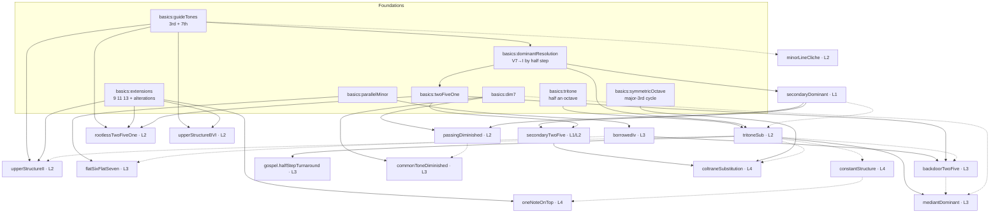

# Teach one atomic step at a time

Reharm Lab's information overload has a single root cause. **The app opens at the last stage of learning (theory prose) instead of the first (hearing it), and it explains each move in six unconnected voices.** The fix is a deterministic lesson layer in theory-core that breaks every move into 3–5 atomic steps, in the order hear, see on the keys, name, then the rule. That layer becomes the single source for the move card, the Coach, the Deep Dive prompt and the demo. Around it go a prerequisite graph that says "Recommended first" but never locks, and a strict two-level disclosure on every screen. The research behind this is strong where it matters. Working memory holds **about 4 chunks** ([Cowan 2001](https://www.researchgate.net/publication/11830840_The_magical_number_4_in_short-term_memory_A_reconsideration_of_mental_storage_capacity)). Explanations a learner already understands **actively slow experienced learners down** (the expertise-reversal effect) ([Kalyuga et al. 2003](https://mrbartonmaths.com/resourcesnew/8.%20Research/Explicit%20Instruction/The%20Expertise%20Reversal%20Effect.pdf)). Cutting extraneous material and teaching names before the move are among the largest effects in multimedia learning (coherence d ≈ 0.86, pre-training d ≈ 0.75–0.92) ([Cambridge Handbook ch. 12](https://www.cambridge.org/core/books/abs/cambridge-handbook-of-multimedia-learning/principles-for-reducing-extraneous-processing-in-multimedia-learning-coherence-signaling-redundancy-spatial-contiguity-and-temporal-contiguity-principles/CD5B7AE1279A9AB81F8EEBB53DBEC86E); [UNH/Mayer handout](https://www.unh.edu/teaching-learning-resource-hub/sites/default/files/media/2023-06/itow-research-based-principles-for-designing-multimedia-instruction-mayer.pdf)). Your tritone-sub complaint is the expertise-reversal effect in miniature. The current card puts the tritone, the role swap, the enharmonic respelling, the bass motion, Lydian dominant and melodic minor in one block, and it misstates the respelling while doing so. The plan below runs in five phases. Phase 0 fixes the copy bugs and costs one session. The concept graph and Coach "Learn" stage come in phases 2–3. The `/api/explain` rewrite with a `PROMPT_VERSION` bump comes in phase 4. All of it stays inside the repo's rules: theory-core decides every pitch, the LLM writes prose only, and the demo makes zero `/api` calls. No source publishes a words-per-card figure, so every word cap in this report is labelled as design judgment.

Throughout, **[R]** marks a recommendation backed by a cited study or primary source, and **[J]** marks design judgment, inferred from the research but not directly tested. Codebase facts cite repo paths, all relative to the repo root and verified at `main` = `19ddf67`.

## The research converges on hear, see, name, then explain

Four independent bodies of work point the same way. Gordon's Music Learning Theory puts aural discrimination first, then verbal association, then symbolic association. **Theoretical understanding comes last**, and in the inference stages the learner is not told the answer ([GIA introduction](https://giamusic.com/page-images/G-8418_Quick%20and%20Easy%20Introductions.pdf); [College Music Symposium](https://symposium.music.org/volume-31/forum-essays-1752877059/music-learning-theory-in-collegiate-music-education)). The products that teach music well follow that order. Duolingo Music replaced "lengthy videos or long-form text" with game-like exercises and introduces notes on a keyboard before the staff ([Duolingo blog](https://blog.duolingo.com/music-course/); [Technical.ly](https://technical.ly/startups/duolingo-music-launch-duocon/)). Hooktheory demonstrates every concept in a real song with synchronized playback, roughly **2–2.5 heard examples per exercise** ([Hooktheory I](https://www.hooktheory.com/books/one)). Open Studio anchors commentary to a moment in a performance, using synced notation and an overhead keyboard view ([Open Studio Jazz Piano Method](https://www.openstudiojazz.com/courses/jazz-piano-method/)). Brilliant's "problem-first" pacing is reported only by third-party reviews, so treat it as anecdotal ([Nibble review](https://nibble-app.com/blog/is-brilliant-worth-it)). Reharm Lab's Study card does the reverse. It opens on `move.text.theory`, which is step 6 of Gordon's sequence, while the A/B audio that would be step 1 sits in the transport bar, far from the explanation.

Cognitive load theory explains why the wall of text hurts an intermediate player even when every sentence is correct. Element interactivity "is always relative to the level of expertise" of the learner. For you, Dm7–G7–Cmaj7 is one chunk, but "G♭ Lydian dominant uses exactly the same 7 notes as C altered" is several new interacting elements ([Kalyuga et al. 2003](https://mrbartonmaths.com/resourcesnew/8.%20Research/Explicit%20Instruction/The%20Expertise%20Reversal%20Effect.pdf)). The same review documents two further effects. **Redundant explanation is hard to ignore**: experienced electrical trainees did better with a diagram alone than with diagram plus text. And explanatory notes that helped novice readers "retarded learning" for knowledgeable ones. The design consequence is that the app should tailor the amount of explanation to each learner, and collapse it once a concept is familiar. Showing everything to everyone and calling it thoroughness is the wrong default [R]. Two further findings shape the step sequence. Novices learn high-interactivity material better when they meet the elements in isolation first and the interacting whole second (Pollock, Chandler & Sweller 2002). Worked examples should then be faded gradually rather than switched off at once (Renkl et al. 2002) ([Kalyuga et al. 2003](https://mrbartonmaths.com/resourcesnew/8.%20Research/Explicit%20Instruction/The%20Expertise%20Reversal%20Effect.pdf)).

For gating, the evidence favours a default path with escape hatches. Duolingo made its recommended order the default in 2022 "to simplify Duolingo" and to make review part of moving forward. It reported better reading and listening scores on the new path (the study was company-run), at the cost of complaints about lost freedom ([NBC News](https://www.nbcnews.com/tech/tech-news/duolingos-update-redesign-luis-von-ahn-interview-rcna44655); [Duolingo efficacy blog](https://blog.duolingo.com/results-duolingo-efficacy-studies); [duoplanet](https://duoplanet.com/duolingo-new-learning-path-review/)). Khan Academy lets learners "jump ahead to a Quiz or unit test and prove your knowledge" ([Khan Academy support](https://support.khanacademy.org/hc/en-us/community/posts/115001845151-Update-May-2018-New-Unit-Mastery-beta-testing)). A meta-analysis of 41 studies found that choice raises intrinsic motivation and performance, most strongly with **2–4 choices** ([Patall et al. 2008](https://selfdeterminationtheory.org/wp-content/uploads/2019/10/2008_PatallCooperRobinson_PsychBulletin.pdf)). No study directly compares hard and soft prerequisite locks, so "never hard-lock" rests on the autonomy evidence plus your own precedent: the Changes game keeps all levels open with a "next up" marker. For disclosure depth, NN/g's guidance is to **never exceed two levels** and to make the advanced path visibly labelled ([NN/g](https://www.nngroup.com/articles/progressive-disclosure/)). That is expert guidance from 2006, not a controlled result.

## Part 1. Style guide: one idea per step, real notes, sound first

### The rules, with their evidence status

The house voice is "a great jazz teacher at the keyboard with a strong student": concrete note names, a payoff the ear can verify, real terms used without apology and glossed once. Bernstein named counterpoint to children and taught Dorian with a Beatles song. He opposed dumbing down, not hard terms ([Interlude.hk](https://interlude.hk/leonard-bernsteins-young-peoples-concerts-born-on-august-25-1918making-classical-music-irresistible/)). The Heaths' remedy for the curse of knowledge is concreteness, not simplification. In Newton's tapping study, tappers predicted that 50% of listeners would name the song. Only 2.5% did ([NPR](https://www.npr.org/2007/02/19/7486659/the-secret-behind-why-ideas-stick)). An explanation like "shares guide tones" is the tapped song. "The B in G7 is the C♭ in D♭7" is the tune.

| # | Rule | Status |
|---|---|---|
| 1 | **One new idea per step**, with at most **4 highlighted elements** on screen (e.g. the two guide tones, the old root, the new root). | [R] ~4-chunk limit ([Cowan 2001](https://www.researchgate.net/publication/11830840_The_magical_number_4_in_short-term_memory_A_reconsideration_of_mental_storage_capacity)); segmenting d ≈ 0.79 ([Cambridge Handbook ch. 11](https://www.cambridge.org/core/books/abs/cambridge-handbook-of-multimedia-learning/principles-for-managing-essential-processing-in-multimedia-learning-segmenting-pretraining-and-modality-principles/4110A2275F6DCD02DAB1F8B37BA7E5CE)) |
| 2 | **Step text: one or two sentences, ≤ 20 words total. Headline ≤ 20 words. No sentence anywhere over 25 words; average about 15.** | [J] for the per-step cap. The sentence limits are [R]: comprehension is above 90% at a 14-word average and gets difficult at 25 words ([Inside GOV.UK](https://insidegovuk.blog.gov.uk/2014/08/04/sentence-length-why-25-words-is-our-limit/); [GOV.UK](https://guidance.publishing.service.gov.uk/writing-to-gov-uk-standards/writing-guidelines/clear-language/)). **No source gives a words-per-card figure.** |
| 3 | **Sound or keys before the name.** Every step carries ▶ Hear or a highlighted keyboard, and the label sits *on* the key, not in a legend beside it. | [R] Gordon MLT; spatial contiguity d ≈ 1.10 ([UVic chapter](https://edtechuvic.ca/wp-content/uploads/sites/11/2022/09/principles-for-reducing-extraneous-processing-in-multimedia-learning-coherence-signaling-redundancy-spatial-contiguity-and-temporal-contiguity-principles.pdf)) |
| 4 | **Headline first.** The first sentence names the swap and what the ear gets: "Play X instead of Y. [audible payoff]." | [R] inverted pyramid ([NN/g](https://www.nngroup.com/articles/inverted-pyramid/)); LLM output needs to be told to do this ([NN/g GenAI](https://www.nngroup.com/articles/genai-write-for-the-web/)) |
| 5 | **Name at least two real notes in every explanatory step.** Spell them exactly as the engine does (C♭, F♭), and give the enharmonic twin in a parenthesis the first time only: "C♭ (the same key as B)". | [R] concreteness ([Made to Stick notes](https://www.nateliason.com/notes/made-stick-chip-dan-heath)); spelling is CLAUDE.md §2 rule 3 |
| 6 | **One term per concept, and one name per chord.** Never call the same chord G♭9 in one sentence and G♭7 in the next. Choose "tritone sub" over "♭II7 substitution" in prose, and keep ♭II7 for the formula. | [R] Federal Plain Language Guidelines: synonyms confuse ([FDA PDF](https://www.fda.gov/media/85771/download)) |
| 7 | **Jargon: at most one new term per step and two per lesson.** Gloss each in ≤ 8 words on first use, through a glossary chip, never a paragraph. Don't define chord symbols, ii–V–I, 3rd/7th or "dominant" for the default reader. Do gloss rule-specific names (backdoor, upper structure, the Family, constant structure, tonicize). | [R] define where used, not the obvious ([FDA PDF](https://www.fda.gov/media/85771/download)); over-defining alienates experts ([NN/g](https://www.nngroup.com/articles/plain-language-experts/)). The caps are [J]. |
| 8 | **Active voice with the note or chord as the subject.** Use one vivid verb per sentence: slides, leans, lands, borrows, holds. | [R] GOV.UK/OPM plain language ([OPM](https://www.opm.gov/information-management/plain-language/)) |
| 9 | **One metaphor family per explanation, tied to a note in the same sentence.** Prefer Larson's forces: magnetism for the half-step pull, gravity for falling resolution, inertia for sequences. Say where the analogy breaks if it could mislead. | [R] Larson's musical forces ([IU Press](https://iupress.org/9780253356826/musical-forces/)); analogies are "double-edged swords" ([Glynn, ERIC](https://files.eric.ed.gov/fulltext/ED373306.pdf)) |
| 10 | **Describe a move by where it lands** ("so bar 11 arrives on F6 from a half step above"). | [R] Galper's forward motion ([halgalper.com](https://halgalper.com/articles/understanding-forward-motion/)) |
| 11 | **Banned filler and hype:** simply, just (meaning easy), of course, obviously, basically, magical, lush, sophisticated, spice up, jazzy, game-changer, secret, unlock, "Let's dive in", "It's important to note". | [J] synthesized from style-guide principles; no source lists these phrases |
| 12 | **Voice chart:** warm but not cute; precise but not academic; brief but not curt; confident but not hype. Encouragement states the result ("bar 9 now lands on C from above"), never praise. | [R] for the "X but not Y" pattern ([Mailchimp guide](https://codepen.io/mcbzz/pen/ZjRVpv)); the pairs themselves are [J] |
| 13 | **The recreate rule is one imperative sentence that works in any key**, written in degrees, intervals and functions, never note names. | Already a prompt rule (`apps/api/src/prompt.ts`), and the engine templates comply |

Two spelling rules from theory-core belong in the guide because the lessons depend on them. A tritone sub's root is the **♭5 of V** (G → D♭, C → G♭), never the ♯4 (C♯, F♯), because `transpose(chord.root, "b5")` keeps letter steps (`packages/theory-core/src/rules.ts:178`). Its ♭7 keeps its letter: D♭7's 7th is C♭, not B ([Neirocca](https://neirocca.com/en/learn/modern/tritone-substitution)).

### Copy bugs to fix first

Four defects in the shipped text are worth fixing before any redesign, because the demo serves them to every visitor.

**Bug 1: the tritone sub's shared-tritone sentence is half wrong.** The template at `packages/theory-core/src/rules.ts:193-194` renders as "C7 and G♭9 share the same tritone: E–B♭ (3rd and ♭7 of C7) are F♭–B♭ (♭7 and 3rd of G♭7), the same keys spelled differently" (`apps/api/demo/explanations.json`, `dominant.tritoneSub@10.1`). The pairing is correct (E = F♭, B♭ = B♭). But "the same keys spelled differently" is true of **only one of the two notes**: B♭ is spelled identically in both chords. The reader has to decode two hyphenated pairs that look like different intervals.

**Bug 2: one chord, two names.** The substitute is built with a 9th (`mk(subRoot, "7", chord.beats, ["9"])`, `rules.ts:179`). So `ps(sub)` prints "G♭9" in the summary and the first clause, while the theory hard-codes `${pn(subRoot)}7` and prints "G♭7" for the same chord a few words later. That breaks rule 6. The same split appears at bars 8.3 and 11.3 (A♭9 against A♭7).

**Bug 3: the backdoor text says "with no tritone resolving".** E♭7 *contains* a tritone, G–D♭, and its D♭ does fall a half step to C. What the backdoor lacks is the **leading tone** (E natural) and C7's E–B♭ tritone resolving inward to F–A. The demo text (`modal.backdoorTwoFive@10.1` in `apps/api/demo/explanations.json`; template at `packages/theory-core/src/rulesAdvanced.ts:60-68`) should say that.

**Bug 4: "briefly makes it sound like home" when the target already is home.** The secondary ii–V L2 branch (`rules.ts:73-91`) is written for tonicizing a non-tonic target. At Co-op Blues bar 2, though, the target is F6, the I chord, so the rendered sentence "F6 is the I chord. Putting its own ii–V in front briefly makes it sound like home" contradicts itself. The template needs a branch for a tonic target.

These sit alongside two non-copy inconsistencies. The `ruleset.ts:6-11` doc comment and `docs/STATE_OF_THE_UNION.md` still describe 11 rules. And the move card prints raw style-tag slugs (`modal-interchange`, `bill-evans`) through `move.styleTags.join(", ")` (`apps/web/src/components/MoveCard.tsx:54`).

### Rewrite 1: tritone substitution (Co-op Blues, bar 10, C7 → F6, key of F)

**Current, as rendered** (summary, theory and insight together on the expanded card; the demo Deep Dive repeats the theory and insight verbatim):

> Swap C7 for G♭9, the dominant a tritone away.
> C7 and G♭9 share the same tritone: E–B♭ (3rd and ♭7 of C7) are F♭–B♭ (♭7 and 3rd of G♭7), the same keys spelled differently. That interval is what makes a dominant want to resolve, so the substitute still lands on F6. The difference is the bass, which now slides down a half step (G♭ → F) instead of falling a 5th.
> G♭ Lydian dominant uses exactly the same 7 notes as C altered: both are modes of D♭ melodic minor. Soloing over the sub is the same as playing altered over the original.

**Current pedagogy, Coach card** (28 words, one sentence): "Dominant chords a tritone apart share the exact same 3rd and ♭7 (with roles swapped), so the tritone still resolves while the bass slides down by half step."

**After.** The headline stays on the card face at level 1. The steps open one at a time at level 2, in the stepper. The Lydian-dominant fact moves to the optional last item.

Headline (18 words): **"Play G♭9 instead of C7. It keeps C7's two tense notes, but the bass slides down a half step into F6."**

| Step | Text (≤ 20 words) | What the screen shows |
|---|---|---|
| 1 | A tritone is exactly half an octave: six half steps. | Keyboard: C and G♭ lit, six half steps counted between them. ▶ the interval. |
| 2 | Go up a tritone from C, the V of F, and you land on G♭: the ♭II. | Keyboard: C → G♭ arrow. Lead sheet: bar 10 washed. |
| 3 | C7's guide tones are E and B♭. G♭7 holds the same two keys, roles swapped: B♭ is its 3rd. | Two chords side by side. E and B♭ lit in both; on G♭7 the E key is labelled "F♭ (♭7)". Chip: *New to guide tones? Learn that first.* |
| 4 | Both chords pull the same way: E rises to F, B♭ falls to A. That's the resolution into F6. | Arrows on the keys. ▶ C7 → F6, then ▶ G♭9 → F6. |
| 5 | What changes is the bass: G♭ slides down a half step to F instead of C falling a fifth. | ▶ A/B of bar 10–11 with the band, Original/Reharm toggle on the same lead sheet. |

Rule (17 words): **"Over any dominant 7th resolving down a fifth, try the dominant 7th a half step above the target."**

Go deeper (optional, after step 5): "Every note of G♭9 is a chord tone or an altered tension of C7. G♭ is the ♭5, D♭ the ♭9, A♭ the ♭13. That's why G♭ Lydian dominant and C altered share all seven notes: both are modes of D♭ melodic minor."

New pedagogy `whyItWorks` (20 words, two sentences): "Both dominants hold the same two guide tones, with the roles swapped. Same pull into I; the bass now slides by half step."

The **key-agnostic Coach lesson** is the same five steps in C, generated from the engine. Step 3 reads: "G7's guide tones are B and F. D♭7 holds the same two keys: F is its 3rd, C♭ (the same key as B) its ♭7." Step 4 reads: "B rises to C, F falls to E." Step 5's bass is D♭ → C. Step 3 is also where your step 4 belongs. **The "learn guide-tone resolution first" link sits at the step that uses the idea, not only at the top of the lesson.** That is pre-training delivered just in time [R for pre-training; J for placement].

The rewrite holds up musically. In F, C7 = C E G B♭ and G♭9 = G♭ B♭ D♭ F♭ A♭. The E of C7 is G♭7's F♭ (♭7), and the B♭ is G♭7's 3rd. E→F and B♭→A resolve to F6's root and 3rd. D♭ melodic minor's 4th mode is G♭ Lydian dominant and its 7th mode is C altered. This matches the consensus explanation: the same tritone with roles swapped on a different root, so the bass slides ([Wikipedia](https://en.wikipedia.org/wiki/Tritone_substitution); [Open Music Theory](https://viva.pressbooks.pub/openmusictheory/chapter/substitutions/)).

### Rewrite 2: secondary ii–V, "ii–V into the I" (bar 2, B♭7 → Gm9 → C7(♭9) → F6)

**Current** (summary and theory):

> Replace B♭7 with the target's own ii–V: Gm9 → C7(♭9) → F6.
> F6 is the I chord. Putting its own ii–V in front briefly makes it sound like home: C is a perfect 5th above F, and G is a 5th above that. The guide tones barely move: B♭ → B♭ → A, F → E → F. You give up the colour of B♭7 and get the strongest pull in tonal harmony instead: the root falls a 5th, twice.

The guide-tone chain is correct, but it is unlabelled: two arrows of letters with no indication of which voice is which. Bug 4 applies to the second sentence. "The strongest pull in tonal harmony" drifts toward hype.

**After.** Headline (16 words): **"Swap bar 2's B♭7 for Gm9 → C7(♭9): a ii–V that walks you back into F6."**

| Step | Text | Screen |
|---|---|---|
| 1 | C7 is the V of F: its root falls a fifth to F. | Roots C → F on the keys. ▶ |
| 2 | Gm9 is the ii: a fifth above C, it leads into C7 the same way. | Roots G → C → F. |
| 3 | Gm9's F slides down to E, C7's 3rd. Its B♭ holds and becomes C7's 7th. | Two voices labelled on the keys, moving voice in red pen. |
| 4 | Into F6, E rises to F and B♭ falls to A. | ▶ the full Gm9 → C7(♭9) → F6, voices animated. |
| 5 | The trade: you lose B♭7's bluesy IV colour and gain a stronger arrival on F. | A/B toggle on bars 2–3. |

The rule stays as written, because it already complies: "Any major or minor chord can get its own ii–V: from the target, go up a 5th for the V and another 5th for the ii." An optional deeper line: "C7's ♭9, D♭, falls a half step to C, F6's 5th."

### Rewrite 3: backdoor ii–V (bar 10, C7 → B♭m7 → E♭9 → F6)

**Current:**

> B♭m7 and E♭9 are borrowed from F minor (iv and ♭VII7). E♭9 has no leading tone. Its ♭7 (D♭) falls a half step to C, the 5th of F, its 3rd (G) moves a step into the tonic chord, and the root rises a whole step home. It's a darker, bluesier cadence than C7 → F6, with no tritone resolving.

The text packs three voice motions into one 30-word sentence and ends on the inaccuracy flagged in Bug 3.

**After.** Headline (18 words): **"Come home from below: B♭m7 → E♭9 → F6. Darker than C7, with no E leaning up into F."**

| Step | Text | Screen |
|---|---|---|
| 1 | Borrow two chords from F minor: B♭m7 (iv) and E♭7 (♭VII7). | F major and F minor scales stacked; the borrowed notes A♭, D♭, E♭ in sage. |
| 2 | E♭9 has no E natural, so no leading tone pushes up into F. | E key greyed, dashed-ghost style. ▶ C7 → F6 vs E♭9 → F6. |
| 3 | Its D♭ falls a half step to C; its root E♭ climbs a whole step to F. | Two arrows on the keys. |
| 4 | Its 9th is F: home is already sounding before you arrive. | F lit in both chords. |

The rule is unchanged: "For a major I, approach from iv m7 → ♭VII7: the minor chord a 4th above the tonic, then the dominant a whole step below it." The prerequisite chip reads "Builds on: borrowed iv". Step 4 states, with concrete notes, what the pedagogy calls "common-tone warmth" (`rulesAdvanced.ts:38-43`). The misconception the lesson should pre-empt is reading Misty's A♭m7–D♭7 as a secondary ii–V. It is a backdoor resolving *up* a whole step ([LJS turnarounds](https://www.learnjazzstandards.com/blog/jazz-turnarounds/)).

## Part 2. A prerequisite graph that recommends but never locks

### Seventeen rules, nine new foundation nodes, two kinds of edge

The teaching literature agrees on the trunk. Intervals and triads come first, then 7th-chord qualities, diatonic function, the ii–V–I, guide tones and shells, and secondary dominants. Substitute dominants, the related ii, diminished passing chords and modal interchange follow, and multitonic cycles come last. That order appears in Levine's *Jazz Theory Book*, which ends Part III with Coltrane Changes ([jazzbooks.com sample](https://www.jazzbooks.com/mm5/samples/D-MLT.pdf)), and in Berklee Harmony 2–4, where secondary dominants come in H2, substitute dominants and related ii-7 in H3, and constant structures in H4 ([Berklee course descriptions](https://www.berklee.edu/online-registration-manual/course-descriptions/harmony); [HR-212](https://college.berklee.edu/courses/hr-212)). Reharm Lab's 17 rules sit in the middle and top of that trunk. The app needs **foundation nodes that are not rules** for everything below them. Those are new concept ids with a `basics:` prefix, alongside the existing `ear:` and `shape:` families in `packages/theory-core/src/concepts.ts`.

A **hard** edge means you can't follow the move's explanation without the prerequisite, and it triggers "Recommended first". A **soft** edge means the prerequisite helps, and it shows only as "Pairs well with" on the concept page. The graph below is a synthesis [J], built on the cited orderings. One edge departs from the research notes' DAG, and the reason is given below the diagram.

Solid arrows are hard edges and dotted arrows are soft. Most edges map directly to cited teaching sequences. The tritone sub rests on the tritone, dominant function and the shared, swapped guide tones ([Wikipedia](https://en.wikipedia.org/wiki/Tritone_substitution)). The backdoor rests on the borrowed iv, then ♭VII7, then the combined cadence ([LJS backdoor](https://www.learnjazzstandards.com/blog/learning-jazz/jazz-theory/backdoor-progression/)). The passing ♯I°7 is a rootless VI7(♭9), the V7 of ii ([jazzguitar.be](https://www.jazzguitar.be/blog/diminished-chords/)). Coltrane changes rest on ii–V–I and dominants of distant keys related by major thirds ([LJS Coltrane](https://www.learnjazzstandards.com/blog/understanding-coltrane-changes-part-1/)). The rootless and upper-structure rules rest on shells plus extensions ([piano.org](https://piano.org/theory/rootless-voicings/); [PianoGroove UST](https://www.pianogroove.com/jazz-piano-lessons/upper-structure-triads/)). The mediant dominant is placed after the tritone sub because the four dominants a minor third apart share one °7: in F, C7, A7, G♭7 and E♭7 all share E–G–B♭–D♭. The rule's own insight text already calls the tritone sub and the backdoor ♭VII7 members of that "Family" (`rulesAdvanced.ts:116-117`).

**Where I depart from the notes' DAG [J]:** it makes secondary dominants a *hard* prerequisite of the tritone sub. To sub the primary V7 → I, you need only V7 → I and the tritone. Your own complaint lists exactly those, plus dominant 7ths and guide-tone resolution. So in this graph the secondary dominant is a soft edge. The tritone sub becomes reachable after three foundation nodes, not after the L1 moves. Levine's piano book supports this, teaching tritone substitution in chapter 6, before rootless voicings in chapter 7 ([jazzbooks.com TOC](https://www.jazzbooks.com/mm5/samples/D-JP.pdf)).

The curriculum tier and the level dial should stay separate concepts. The dial means "adventurousness plus density": `DENSITY` runs from 1 move per 8 bars at L1 to uncapped at L4 (`packages/theory-core/src/pathway.ts:7-28`). The graph means "learning order". They mostly agree, but the dial's labels do not match its contents. L2 "Bebop" holds both upper structures and rootless voicings. L3 "Gospel" holds four modal moves and one gospel rule. L4 "Modern" holds a Bill-Evans-tagged ballad device (`apps/web/src/design/tokens.ts:58-64`). That mismatch is part of the confusion, and it is listed under decisions below.

### Concept states come from data the app already stores

The SM-2 store already has what a soft-lock needs. `concept_reviews` is keyed by `(ruleId, keyTonic)` with reps, ease, `dueAt`, `cleanRuns` and `lastGrade` (`apps/api/src/db/schema.ts:58-153`). `summariseProgress` returns `cleanKeys` and `due` per concept and is shared by the API and the demo (`packages/theory-core/src/srs.ts:165-218`). Foundation nodes can borrow evidence from families that already exist. The Changes game's `ear:landing` mastery (V → I in all 12 keys) is evidence for `basics:dominantResolution`. `ear:setup` is evidence for `basics:twoFiveOne`. Clean `shape:shell:*` runs from Voicings are evidence for `basics:guideTones`. **For the most important foundations, no new graded drill is needed.**

| State | Derived from | Chip | Visual (existing design idioms) |
|---|---|---|---|
| New | no attempts, lesson not opened | none | plain ink card |
| Recommended first | any **hard** prereq below Familiar | "Recommended first: Guide tones →" | dashed `ink-soft` border, the "before/ghost" idiom; still clickable |
| Learning | lesson opened, or attempts with 0 clean | "Learning" | solid ink border |
| Familiar | lesson finished, **or** ≥ 1 clean key, **or** borrowed ear/shape evidence | "Familiar" | thin mustard wash |
| Proficient | clean in ≥ 4 keys | "n/12" | sage wash |
| Mastered | clean in ≥ 8 keys, last grade ≥ 4, nothing overdue | CLEAN stamp | sage wash plus the red-pen stamp |
| Due | any key with `dueAt` ≤ now | "Due" | red-pen dot |

The thresholds are [J]. Khan uses 70% for Familiar ([Khan support](https://support.khanacademy.org/hc/en-us/community/posts/115001845151-Update-May-2018-New-Unit-Mastery-beta-testing)). Your out-of-repo strategy doc proposes ≥ 90% over the last 20 attempts. Today one clean run stamps a key. Your real database holds only 8 reviews and 8 attempts (`docs/HANDOFF.md:16`), so any rule has to behave sensibly when the history is nearly empty, and the table above does: everything starts New or Recommended first.

### How a soft lock behaves

**Nothing is ever disabled.** A Recommended-first concept opens normally. Its first lesson screen carries a one-line inline note in red pen, not a modal: "This builds on guide-tone resolution (3 steps)". Two buttons follow: **Learn that first** and **Continue anyway**. Continue anyway is remembered per concept, so the note never nags twice. The prerequisite link repeats inside the step that uses the idea, as in step 3 of the tritone lesson. An **"I know this"** button runs a short performance check: the move played clean in two random keys through the existing grading. Passing it marks the concept and its hard prerequisites Familiar. That copies Khan's and Yousician's skip-by-test rather than self-report ([Piano Dreamers on Yousician](https://www.pianodreamers.com/yousician-piano-review/)). The check is reversible: a failed run leaves the concept Learning, and Familiar can be cleared. That avoids the non-undoable-placement complaint Duolingo draws ([Duolingo wiki](https://duolingo.fandom.com/wiki/Jump_here%3F)).

**"Next up"** is the lowest-tier concept whose hard prerequisites are Familiar but which isn't Familiar itself. Ties break by `RULES` order, which already encodes priority. The default view offers 2–4 such choices, never the whole list [R, Patall]. Due reviews fold into the same "next" list, as Duolingo did, instead of sitting in a separate queue [R]. This mirrors `useChangesProgress.nextUp` (`apps/web/src/components/changes/useChangesProgress.ts:23-34`), which follows the Changes decisions you already made: all levels open, a "next up" marker, never demote.

**The demo build needs one guard.** Until a visitor's first run, practice history reads from the seeded `demoHistory.json`. CLAUDE.md §2 rule 11 says seeded data must never be presented as real. A path saying "Tritone sub: Proficient" because of a made-up player's history would break that rule. **Recommendation [J]: path states ignore the seeded sample and use only this browser's own runs and lesson flags.** The passport keeps its red "Sample notebook" notice as it does now (`apps/web/src/components/progress/PracticeDashboard.tsx:103-108`).

## Part 3. Each screen shows one headline and hides the rest

### The budget per view

The inventory estimates Study's first load at **70–90 interactive controls plus ~15 text and visual blocks**. A selected move card shows up to 11 blocks at once, and the first move auto-expands (`apps/web/src/App.tsx:203`; `MoveCard.tsx:81-163`). Some controls appear twice: two master VolumeMixers on Study (`TransportBar.tsx:79`, `ImprovHeatmap.tsx:752`) and Ghost Master trading on both Study and Practice. Two rules govern the redesign. First, **at most two disclosure levels** per object, with no third nesting [R, NN/g]. Second, **comparison material stays together**: Original/Reharm remains a toggle on the same lead sheet. NN/g's hotel example shows that splitting things users alternate between hurts [R] ([NN/g](https://www.nngroup.com/articles/progressive-disclosure/)). There is no analytics data on which panels get used, so the "primary" set below is [J]. NN/g recommends choosing it by frequency of use, so instrument drawer and panel opens as part of the same work.

### Screen by screen

| Screen | Default first load (level 1) | One click away (level 2) | Remove or move |
|---|---|---|---|
| **Study** | Title and meta; mode tabs; key picker; level dial; Original/Reharm toggle; lead sheet with washes; Play; "Reharm & tricks" with the 3 L2 moves as **collapsed cards**: title, chord route, headline, ▶ before/after. The first move is selected on the lead sheet but shows only level 1. | **"Why it works (5 steps)"** opens the stepper inline; its last item is "Go deeper" (melody check, voice-leading grid, insight, Deep Dive). "Edit chord by chord ▾" (the `ChordMoveSelector`). "15 considered and rejected ▸". "Solo over it ▸" (ImprovCard plus heatmap). Band, count-in and loop behind "Band ▾" on all widths, as phones already do. | Second VolumeMixer; Ghost Master trading (Practice only); raw style-tag slugs (map to readable words or drop); the permanent help paragraph (becomes a one-time dismissible hint); ThemeSwitch out of every header into a settings menu. Engine X-ray stays a toolbar button, since it is the portfolio showpiece, but never nests inside a move. |
| **Coach** | Left rail: **"Your path"**, the concept list grouped by tier with state chips and 2–4 "next up" items marked in red pen; "Due" only when something is due. Centre: for an unlearned concept, **Learn step 1**; otherwise the drill, showing the current key and "Next key →". | Full 12-key ribbon behind "All keys ▾"; grading mode behind "Mode ▾"; the "Why this works" card collapsed to formula + headline + rule, with "Why? (5 steps)" reopening the lesson; Random key and the two checkboxes under "Options". | The footer paragraph; the duplicate formula · whenToUse line in the right rail (already in the list and the Why card); the flat "All 17 Jazz Concepts" heading. |
| **Changes** | Unchanged. It is already the most scaffolded screen (Intro, Guided → Choices → Open, "next up"). | Glossary chips on terms; after a "real jazz move" alt line, a "Learn the tritone sub →" link into the Coach lesson. | Nothing. |
| **Voicings** | Unchanged ("start here" on Shells; only Shells / Close / Drop 2 shown). | Glossary chips for "guide tones", "rootless", "Close (rootless)"; a "Recommended first: Shells" chip on rootless shapes. | Nothing. |
| **Practice** | Performance mode: lead sheet + HUD + tape, as now. | The inline 12-entry shortcut legend at `xl` moves behind ⌨; a glossary chip on "Don't hold:" (avoid notes) and on "enclosure" in the heatmap legend. | Nothing else. Practice is for concepts you already know, so it explains least. |
| **Drawers** | Passport opens on "Today's practice". | A new **"Path"** tab: the concept graph with states. X-ray and Proof unchanged. Setlist unchanged. | In the demo, hide the Deep Dive button unless Claude-written text exists. Today it repeats the card's theory and insight verbatim (`apps/web/src/demo.ts:26-38`). |

Several mechanisms carry across screens. **Glossary chips** are a dotted underline that opens a tap or hover popover with a ≤ 8-word gloss and a "Learn it" link. They replace native `title` tooltips for terms, which don't work on touch and can't hold a link. **Fading** collapses a concept's stepper to "headline + rule" once it is Familiar, the expertise-reversal remedy [R]. A one-line setting, "Explanations: step by step / just the rule", is the fast path for you [J]. **First-run hints** are one dismissible line per screen, stored as `reharm.hint.<screen>` in localStorage with the usual try/catch wrapper. The app has no onboarding or "seen" flag today: a grep of `apps/web/src` for onboard, tutorial, first-run, welcome and seen finds only a comment in `deepLink.ts`. Everything new uses existing primitives: `SketchBox` cards, solid and dashed pills, red pen for "you are here", a wash for "done".

### The Coach "Learn" stage

The concept-learning flow belongs inside Coach as a fourth stage in front of the existing three. The house precedent is the Changes ladder, Guided → Choices → Open with auto-promotion and Undo. The stages run **Learn → Study it → Self-check → Play it**. Learn shows one step per screen: ≤ 20 words above a `DoodleKeyboard` with ≤ 4 labelled keys, ▶ Hear, ‹ Back / Next ›, and "Step 2 of 5". Steps 2–4 include one **predict-then-reveal** interaction, such as "Tap the two keys C7 and G♭7 share", answered through `noteBus`, so the virtual keys, QWERTY and MIDI all work [R for interaction-first in Duolingo Music; Brilliant's version is anecdotal]. The last step hands off to the existing ungraded "📖 Study it" (`CoachDrill.tsx:612-684`), then to graded play. Each new stage is a fade from worked example to problem [R, Renkl]. One safety detail: lesson taps must **not** go through the coach-run grader. CLAUDE.md warns that notes injected on the Coach page get graded, and that a finished run is saved to the real database.

## Part 4. Build one lesson source in theory-core, then retire five

### What to add

| Add | Where | Notes |
|---|---|---|
| Concept graph | `packages/theory-core/src/learn/graph.ts` | `CONCEPTS`: the 17 ruleIds + 9 `basics:*` ids, each `{id, tier, hard[], soft[], evidence[]}` where evidence lists `ear:*` / `shape:*` ids. A pure function `conceptStates(progress, lessonFlags)` → state per concept, plus `nextUp()`. Pure, synchronous, deterministic (rule 1). Keep it apart from `concepts.ts`, which remains the practice-history registry. |
| Glossary | `packages/theory-core/src/learn/glossary.ts` | `{term, gloss (≤ 8 words), conceptId?, aliases[]}`. Seed from the audit's term inventory: tritone, guide tones, leading tone, avoid note, upper structure, Lydian dominant, altered, melodic minor, parallel minor/borrowed, rootless A/B, shell, drop 2, constant structure/planing, appoggiatura, tonicize, enclosure, the Family, plus the category and level labels. |
| Lessons | `packages/theory-core/src/learn/lessons/*.ts` | Per concept: `headline(facts)`, `steps(facts): Step[]`, `rule`, `deeper?(facts)`. A `Step` is `{text, highlight: {note, label}[], play?: "interval"|"before"|"after"|"ab", ask?: {kind: "tapNotes", answer}, prereqLink?}`. **Templates read only the `Proposal.facts` computed in `propose()`; they never recompute harmony.** That keeps rule 7 ("traces are the engine; never fork the logic") intact. Add the missing facts fields to proposals (e.g. tritone sub: `subRoot`, the role map, resolution targets). |
| Basics lessons | the same folder | 9 key-agnostic lessons generated through `transpose()` and `guideTones()`, so each one works in all 12 keys. |
| Web UI | `apps/web/src/components/learn/` | `LessonStepper` (used inline in Study and as Coach's Learn stage), `GlossaryChip`, `PrereqNote`, `PathView` (passport tab). Lazy-loaded like the other non-Study screens. |
| Lesson flags | localStorage `reharm.lessons` (v1) | `{conceptId: {seenAt, finishedAt, continuedAnyway}}`. Works in the demo with no `/api` call. A server table later would need `npm run db:generate -w @reharm/api` and committing `drizzle/`. |
| Proof | `packages/theory-core/src/testing/proofs.ts` | A new claim, "Lessons are the engine": for every accepted move across the golden tunes and 12 keys, every note named in a lesson step equals the engine's facts. It runs in CI and in the browser Proof tab, which is also a good portfolio artifact. |

### What to refactor, and the six sources it unifies

Today the same concept speaks in six voices: `MoveText` (A), `pedagogy` (B), `buildStepCue` (C), the Claude Deep Dive (D), the demo Deep Dive file (E), and scattered UI copy (F) such as `FUNCTION_WORD`, scale `why` strings and the Changes motions. Claude never sees `pedagogy` (`apps/api/src/explain.ts:39-73`), so the Deep Dive can't line up with the Coach card. The refactor makes **the lesson the single source** and turns the other layers into views of it:

| Layer | Becomes |
|---|---|
| A `MoveText` | Derived: `summary = headline`, `recreateRule = rule`, `theory = steps joined` (kept as the draft for the LLM and for back-compat), `insight = deeper`. |
| B `pedagogy` | Kept as data. `formula` and `bandstandCue` stay, `whyItWorks` is rewritten to ≤ 25 words, and `whenToUse` feeds the graph's "where it applies" line. |
| C step cues | `buildStepCue` keeps its per-chord role, but its `whyHere` reuses the lesson's fact helpers and glossary terms. The six rules that fall through to the generic cue (passingDiminished, flatSixFlatSeven, borrowedIv, commonToneDiminished, coltraneSubstitution, constantStructure; `coach.ts:52-168`) get real cues from their lessons. |
| D `/api/explain` | Prompt rewrite (below). `buildFacts` adds `pedagogy`, `lesson.steps` (as text), `prereqs` and the glossary entries for terms used. |
| E demo file | Regenerated with `npm run demo:generate -w @reharm/api -- --template` (free). Claude-written demo Deep Dives cost budget: ask before generating them. |
| F Changes copy | Stays separate: it is a different game, its copy has tested constraints, and its warm mental-model voice is the best in the app. It links to concept ids and uses glossary terms. |

**The `/api/explain` prompt** (`apps/api/src/prompt.ts`; `PROMPT_VERSION = "2026-11-11.1"` today) changes in five ways. The reader moves from "an advanced jazz pianist… Do not define basic terms" to "a strong player who knows chord symbols, ii–V–I and the 3rd and 7th, but may not own this move's name". It gets a reason attached, because Anthropic's guidance is that Claude generalizes from the *why* behind a rule ([Claude prompting best practices](https://platform.claude.com/docs/en/build-with-claude/prompt-engineering/claude-prompting-best-practices)). The rules become positive: lead with what the ear gets, name at least two notes from the facts, keep every sentence ≤ 25 words and the summary ≤ 20, gloss at most two terms using the supplied glossary, use one metaphor family tied to a note. The Deep Dive is told **not to restate the steps** the reader has already seen, since that is the redundancy effect. It covers what the steps don't: voicing and touch, the top scale and its guide-tone targets, where else the move works, and when it fails against a melody. The length drops from 150–260 words to about 100–180 [J]. The prompt adds **3–5 varied `<example>`s**: a tritone sub, a backdoor, a passing °7, and a limited case where the melody is unverified [R, Anthropic]. The system prompt itself is written in the target register, since prompt style rubs off on output. A post-check validates the Zod output (banned phrases, sentence length, ≥ 2 fact notes, spelling preserved). On failure it retries once and logs in dev only, which keeps the production console clean (rule 14). Bump `PROMPT_VERSION`. The cache key changes with it, because it hashes `PROMPT_VERSION|MODEL|facts`. The model, effort, fallback beta and `cache_control` settings in CLAUDE.md §2 rule 2 stay as they are.

### What to remove or simplify

Remove the Study-side duplicates: the second VolumeMixer, Ghost Master trading, and the always-open heatmap, which moves behind "Solo over it". Remove raw style-tag slugs, the auto-expanded full card, the always-open rejected list, the Coach footer and its duplicate formula lines, the demo's template Deep Dive button, and ThemeSwitch in every header. Fix the stale `ruleset.ts` doc comment and the 11-rule counts in `STATE_OF_THE_UNION.md`. Collapse the native-`title` tooltips that carry teaching text (`ChordMoveSelector.tsx:341-353`) into glossary chips.

### Phases, with the tests each one touches

| Phase | Scope | Tests and checks touched |
|---|---|---|
| **0. Copy bugs** (≈ 1 session) | Bugs 1–4; one name per chord across all 17 templates; style-tag labels; stale docs. | New theory-core test: at C7 → F6 in F, the tritone-sub text names one symbol for the substitute and states E = F♭. `coopBlues.golden.test.ts` and `someday.golden.test.ts` (the L2 title "ii–V into the IV" must survive). Regenerate the demo file with `--template`. `api.test.ts` reads `move.text` dynamically, so it is unaffected. `npm run typecheck && npm test`. |
| **1. Disclosure only** (no new content) | Study and Coach level-1/level-2 split per Part 3; remove duplicates; one-time hints. | `e2e/golden.spec.ts` must still find "Reharm & tricks", `/^\d+ moves? · /`, "Lead sheet", "Level 0 shows the tune as written.", the radios `/^L0\b/`…`/^L4\b/` in the "Reharm level" group, and "Demo · saves in this browser". Add e2e: on first load the card shows its headline, "Why it works" is collapsed, and the rejected list is one line. Verify in the `web-demo-build` preview (:4174). |
| **2. theory-core `learn/`** | Graph, glossary, and lessons for the first slice: the 4 basics the tritone sub needs plus `basics:twoFiveOne`, and tritoneSub, secondaryDominant, secondaryTwoFive, borrowedIv, backdoorTwoFive. | New `learn.graph.test.ts`: acyclic; all 17 ruleIds mapped; every hard prereq exists; tier ≥ prereq tier. New `learn.copy.test.ts`: step ≤ 20 words, sentences ≤ 25, banned phrases, every glossary term used is defined, no `undefined|NaN`, no ASCII `b` flats (the `ears.motions.test.ts` precedent). A fast-check property: across 12 keys, step notes equal `guideTones()`/`transpose()` output, and the tritone pair has equal pitch classes. The new PROOF. |
| **3. Coach Learn + Path** | Learn stage, soft-lock notes, "I know this" check, Path view, `reharm.lessons`, demo guard (ignore the seeded sample). | New e2e on the demo build: open Coach, see "Recommended first" on the tritone sub, "Continue anyway" opens step 1 (never locked), Next advances one step at a time. Extend `demoHistory.test.ts` so path states don't read the seeded sample. `concepts.test.ts` (`conceptName(r.id) === r.name`) stays green as long as rule names don't change. Test lesson input in Study mode or the demo build, never against the real database. |
| **4. Unify + prompt** | `MoveText` derived from lessons; step cues reuse the fact helpers; `buildFacts` gains pedagogy, steps and glossary; prompt rewrite; `PROMPT_VERSION` bump; output validator. | `practice.test.ts:133-145` (pedagogy and step cues non-empty) adapts. `api.test.ts` demo template fallback. A new validator unit test on fixture outputs. Regenerate the demo file. End-to-end only against a scratch copy of the database, per §0. |
| **5. The other 12 rules + wording pass** | Lessons for the remaining rules (Coltrane with its key-center map first, as LJS advises), adaptive fading from SM-2 grades, then the app-wide wording pass already queued in `docs/HANDOFF.md:23`. | Re-run `npm run e2e`, since it asserts visible text. Keep the `ears.motions` constraints (`/real jazz move/`, `/wider/`, no "V/"). Keep the golden rejection regexes (`/natural 5/`, `/♯9 of B9/`, `/♭9 of D♭maj7/`) unless the reasons are deliberately rewritten. |

The order puts the zero-risk, high-visibility fixes first. Phase 0 changes what every demo visitor reads today. Phase 1 changes no copy at all, so e2e churn stays separate from wording churn. This is also the answer to sequencing against the queued wording pass: **disclosure first, then lessons, then the wording pass over whatever still shows** [J]. Doing the wording pass first would polish text that phases 1–4 then hide or replace.

## Decisions only you can make

Twelve calls are design choices, not research findings. Each is listed with a recommendation.

| # | Decision | Recommendation |
|---|---|---|
| 1 | Mastery thresholds for Familiar, Proficient and Mastered | Start with the table in Part 2 and revisit once there are ~100 attempts. |
| 2 | Rename the dial's level labels (Functional / Bebop / Gospel / Modern don't match their contents) | Use adventurousness words, keeping the `L0`–`L4` prefix that e2e asserts. |
| 3 | First-load level (L2, 3 moves, vs L1, 1 move) | Keep L2: 3 moves fit the ~4-chunk budget once cards are collapsed. |
| 4 | Demo path states: ignore the seeded sample, or show it labelled | Ignore it. |
| 5 | Where lesson flags persist: localStorage, or a server table (needs a migration) | localStorage in v1. |
| 6 | Explanation depth: adaptive per concept, a global toggle, or both; and your own default | Both, with your default "just the rule". |
| 7 | One reader model in the prompt, or an `audience` field in `buildFacts` | One reader (the cache and cost stay simple). |
| 8 | Whether the "I know this" test-out exists in v1 (the Changes decisions said no test-out there) | Yes for Coach. It costs one graded run, and a skip-by-test beats a hard path for an intermediate player. |
| 9 | Hard or soft edge from secondary dominants to the tritone sub | Soft, as argued in Part 2. |
| 10 | Whether a Barry Harris sixth-diminished branch belongs in scope | It is not one of the 17 rules. If added, make it a side branch with level-1 prerequisites only, never gated behind the tritone sub ([barryharrismethod.com](https://barryharrismethod.com/method)). |
| 11 | Spending on Claude-written demo Deep Dives | Ask first, per the existing rule. |
| 12 | Learn inside Coach, or a sixth top-level tab | Inside Coach, as requested. It keeps the tab bar at five. |

## Conclusion

The deeper finding is that the "wall of jargon" is not a vocabulary problem a wording pass can fix. It is a **sequencing** problem. Every fact in the tritone-sub card is something you already know, and the card still confused you. It delivered five interacting ideas at once, in theory-first order, with one sentence mis-describing the respelling. Expertise reversal predicts exactly that experience for an intermediate reader: excess explanation costs a knowledgeable reader as much as it helps a novice. So shortening the copy is not enough. The remedy is ordering and fading: hear it, see the two shared keys, name it, state the rule, and then step aside once the concept is familiar.

The architectural payoff is that the fix strengthens the repo's own principles. Lessons generated from `Proposal.facts` extend "theory-core decides every pitch" from chords to explanations. A proof that lesson notes equal engine facts extends "traces are the engine" to the teaching layer. Making the lesson the single draft the LLM improves on narrows Claude to the job rule 2 already assigns it: prose, never notes. The same structure serves both audiences. A hiring manager sees a headline and a ▶ button in the first 20 seconds, and you get "just the rule" with everything else one click away. The open risk is evidential. Nothing here has been tested on users, and the word caps and thresholds are judgment. So instrument the panel opens in phase 1 and let real usage, not this report, set the primary level.
