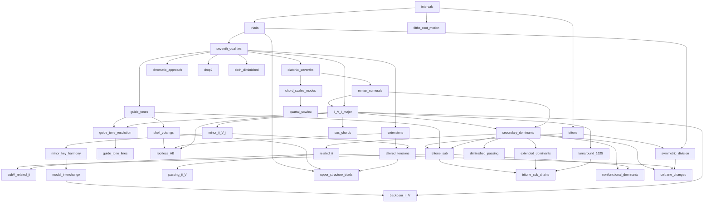

# Pedagogical prerequisite graph (skill tree) for jazz harmony, reharmonization and piano voicings

Scope note: these notes give a sourced prerequisite DAG for a soft-lock "Recommended first" skill tree. Table-of-contents order is cited where I found it. The DAG itself is a synthesis: it sits under Key Question 2, "Inferences", and each node lists the sources it rests on. About 22 searches and fetches went into it (2026-11-20).

---

## KQ1. What order do respected pedagogues and curricula teach these in?

### Takeaway
Every curriculum agrees on the trunk: intervals → triads → 7th-chord qualities → diatonic harmony/roman numerals → ii–V–I → guide tones/shells. They also agree that tritone subs, related ii-Vs, diminished passing chords and modal interchange come after secondary dominants, and that Coltrane/multitonic cycles come last. Where they differ is when voicings are taught relative to theory, and whether harmony is framed by chord scales (Berklee, Levine), by dominants and sixth-diminished (Barry Harris), or sound-first (Open Studio).

### Cited Findings

**Mark Levine, *The Jazz Piano Book* (Sher, 23 chapters).** This book interleaves voicings and harmony.
- Chapter order: 1 Intervals and Triads Review; 2 The Major Modes and II-V-I; 3 Three-Note Voicings; 4 Sus and Phrygian Chords; 5 Adding Notes to Three-Note Voicings; 6 Tritone Substitution; 7 Left-Hand Voicings; 8 Altering Notes in Left-Hand Voicings; 9 Scale Theory; 10 Putting Scales to Work; 11 Practicing Scales; 12 So What Chords; 13 Fourth Chords; 14 Upper Structures; 15 Pentatonic Scales; 16 Voicings, Voicings, Voicings; 17 Stride and Bud Powell Voicings; 18 Four-Note Scales; 19 Block Chords; 20 Salsa/Latin; 21 Comping; 22 Loose Ends; 23 Practice — [jazzbooks.com sample TOC](https://www.jazzbooks.com/mm5/samples/D-JP.pdf); [Gearspace review](https://gearspace.com/board/reviews/1064943-mark-levine-jazz-piano-book.html)
- Levine teaches tritone substitution (ch. 6) before left-hand rootless voicings (ch. 7) and before scale theory (ch. 9). Sus chords come very early (ch. 4). So What and fourth chords (ch. 12–13) and upper structures (ch. 14) come after scale theory — [jazzbooks.com sample TOC](https://www.jazzbooks.com/mm5/samples/D-JP.pdf)

**Mark Levine, *The Jazz Theory Book* (Sher, 1995).**
- Part I runs 1 Basic Theory (intervals, inverting intervals, triads); 2 The Major Scale and the II-V-I Progression; 3 Chord/Scale Theory (major, melodic minor, diminished, whole-tone harmony); 4 How to Practice Scales; 5 Slash Chords — [jazzbooks.com sample, contents p. iii](https://www.jazzbooks.com/mm5/samples/D-MLT.pdf)
- Part II, Improvisation, is ch. 6–12 (Bebop Scales, Outside, Pentatonics, Blues, Rhythm Changes). Part III, Reharmonization, is ch. 13 Basic Reharmonization (p. 259), 14 Advanced Reharmonization (p. 303), 15 Coltrane Changes (p. 351) and 16 Three Reharmonizations (Coltrane and Kenny Barron on "Spring Is Here", Coltrane on "Body and Soul") — [jazzbooks.com sample](https://www.jazzbooks.com/mm5/samples/D-MLT.pdf); [Sher Music](https://www.shermusic.com/1883217040.php)
- Levine's ch. 1 already presents the tritone as the interval that "remains tritone" when inverted (4½ + 4½ = 9). He plants it as an atomic fact on the first pages — [jazzbooks.com sample p. 12](https://www.jazzbooks.com/mm5/samples/D-MLT.pdf)

**Berklee Harmony 2–4** (the official course descriptions).
- **Harmony 2 (HR-112):** major-key harmony with "secondary and extended dominant relationships", guide tone lines, minor-key harmony, subdominant minor, blues — [Berklee course descriptions](https://www.berklee.edu/online-registration-manual/course-descriptions/harmony)
- **Harmony 3 (HR-211):** subdominant minor and modal interchange, chord scale theory, "substitute dominant and related II-7 chords", diminished chord patterns, modulation — [Berklee course descriptions](https://www.berklee.edu/online-registration-manual/course-descriptions/harmony)
- **Harmony 4 (HR-212):** deceptive resolutions of secondary dominants, dominant 7ths without dominant function, contiguous dominant motion, modal harmony, pedal point, compound chords, constant structures — [Berklee HR-212](https://college.berklee.edu/courses/hr-212)
- A Spring 2025 HR-112 syllabus orders the units as Secondary Dominants → Extended Dominants → Deceptive Resolution of Secondary Dominants → Minor Key Harmony/Line Clichés → Introduction to Modal Interchange → Melody/Harmony Relationship — [HR-112 syllabus (studylib)](https://studylib.net/doc/28127196/hr-112-harmony-2-2025sp)
- Berklee Online's Harmony 2 also covers modal interchange — [Berklee Online Harmony 2](https://online.berklee.edu/courses/harmony-2)
- **Minor conflict:** the official HR-211 description puts modal interchange in Harmony 3, but the syllabus and Berklee Online introduce it in Harmony 2. Read it as an introduction in Harmony 2 and the full treatment in Harmony 3.
- The Harmony 2 workbook (Mulholland & Hojnacki) calls subdominant-minor chords the most common modal interchange chords, and names bVII7, bII and V–7 as alternative cadential chords — [Harmony 2 workbook (docdrop)](https://docdrop.org/download_annotation_doc/Harmony-2-3rd-Edition--7cfvh.pdf)

**Nettles & Graf, *The Chord Scale Theory & Jazz Harmony*** (Advance Music 1997, the Berklee textbook).
- Chapter order: 1 Harmonic structures; 2 Diatonic harmony; 3 Dominant chords and diatonic function; 4 Minor key harmony; 5 Blues; 6 Diminished seventh chords; 7 Dominant chords with special functions; 8 Modal interchange; 9 Voicing specific chord symbols and structures; 10 Modulations; 11 Modal systems; 12 Non-functional harmony — [Open Library](https://openlibrary.org/works/OL9053809W/The_chord_scale_theory_jazz_harmony); [Schott](https://www.schott-music.com/en/the-chord-scale-theory-jazz-harmony-no307853.html)
- Ch. 2 includes sus4 chords and diatonic reharmonization. Ch. 4 already introduces "Modal Interchange and Subdominant Minor" and line clichés. Ch. 12 covers multitonic systems, contiguous dominants and constant structures, which is where Coltrane-type cycles sit — [pdfcoffee copy of the TOC](https://pdfcoffee.com/chord-scale-theory-amp-jazz-harmony-b-nettles-richard-graf-4-pdf-free.html). This is a pirated copy; I used it only for the headings.

**Dariusz Terefenko, *Jazz Theory: From Basic to Advanced Study* (Routledge, 2nd ed.).**
- Basics: Fundamentals → Rhythm → Harmonic Function → Four-Part Chords → Five-Part Chords → II-V-I → Modes → Chord-Scale Theory → Blues → Improvisation
- Intermediate: Voicing Formations → Keyboard and Jazz Chorale Textures → Idiomatic Jazz Progressions → Bebop → … → Rhythm Changes
- Advanced: Lead-sheet analysis → Phrase Models → Song Forms → **Reharmonization Techniques (ch. 23)** → post-tonal topics — [Routledge](https://www.routledge.com/Jazz-Theory-From-Basic-to-Advanced-Study/Terefenko/p/book/9781138235106); [B&N](https://www.barnesandnoble.com/w/jazz-theory-dariusz-terefenko/1128917918)
- In the 1st edition, Jazz Reharmonization is ch. 25, again near the end — [Semantic Scholar](https://www.semanticscholar.org/paper/Jazz-Theory:-From-Basic-to-Advanced-Study-Terefenko/78a815664e7649e946e9fcaf533060d55833a741)
- In both editions harmonic *function* comes before chord construction (ch. 3 vs 4), and reharmonization is treated as an advanced, culminating topic.

**Barry Harris method** (reconstructed in 16 stages).
- Foundations (rhythm, "the musical universe", where chords come from, running scales) → **Lines** (added-note rules, line devices, phrases over changes) → **Harmony**:
  - Stage 8: Thinking dominant
  - Stage 9: Sixth chords and the sixth-diminished scales
  - Stage 10: Movement — borrowing, drop voicings, "sixth, sixth, sixth instead of ii-V-I"
  - [barryharrismethod.com/method](https://barryharrismethod.com/method)
- Harris has the soloist "put the ii chord away" and think in dominants. A minor 7th is the dominant's "important minor". A half-diminished chord is read as the dominant whose 3rd it is. Minor 7ths are treated as major 6ths, and half-diminished chords as minor 6ths — [barryharrismethod.com/method](https://barryharrismethod.com/method)
- One practice order for the 6th-diminished scale: play the scale → play it in 3rds → harmonize it as chords → change keys → find the dominants inside it → harmonize with drop-2 in 12 keys — [FreeJazzLessons](https://www.freejazzlessons.com/barry-harris/)

**Open Studio (Peter Martin, Adam Maness).**
- Levels: Core Piano Pathway → Jazz Piano Foundations (beginner) → Expansions (intermediate: "colorful voicings") → Jazz Piano Method (advanced) — [Open Studio help](https://openstudio.helpscoutdocs.com/article/575-what-order-should-i-take-the-piano-courses)
- Peter Martin's *Jazz Piano for Beginners* lesson order: Blues → Blues improv → **Shell Voicings: Intro to Chords** → Swing → Wrong Notes → **Basic Jazz Theory** → Triads and Arpeggios → **2-5-1s** → Bebop → Ear Training. This is sound-first: shells are played before theory is formalized — [Open Studio](https://www.openstudiojazz.com/courses/jazz-piano-for-beginners/)
- Adam Maness, *Jazz Piano Basics Vol. 2, Left Hand Voicings*: Root + Half-Shell → Root + Shell → Shell + "Pretty" → Fourths — [Open Studio](https://www.openstudiojazz.com/courses/jazz-piano-basics-vol-2-left-hand-voicings/)
- Adam Maness, *Jazz Chords for Beginners*: Rooted 5-note (solo) → Rootless 4-note (with bassist) → Rootless left hand — [Open Studio](https://www.openstudiojazz.com/courses/jazz-chords-for-beginners/)

**Phil DeGreg, *Jazz Keyboard Harmony* (Aebersold).**
- Runs "step-by-step from 2- to 7-voice chord structures with fourths and upper-structure triads". Each chapter is one voicing type applied to ii-V-I, major cycle and dominant cycle — [Amazon listing](https://www.amazon.com/Jazz-Keyboard-Harmony-Practical-Spiral-Bound/dp/1562240692); [learnjazzpiano.com review](https://www.learnjazzpiano.com/BookReviews/jazz-keyboard-harmony-phil-degreg.html)

**Jamey Aebersold Vol. 3, *The ii/V7/I Progression*.**
- Track order: ii-V7-I in all major keys → ii-V7 random progressions → V7+9-I in all keys → ø-V7+9-i in all minor keys → G minor blues → Bebop tune → ii-V7-I in three keys → F blues with bridge. Major ii-V-I comes before the minor iiø-V7(b9)-i — [Discogs](https://www.discogs.com/release/14489402-Jamey-Aebersold-Volume-3-The-II-V7-I-Progression); [J.W. Pepper](https://www.jwpepper.com/Jamey-Aebersold-Jazz,-Volume---3-(The-ii-V7-I-Progression)/2240034.item)
- Aebersold's Jazz Handbook includes "How to Practice" by Jerry Coker and ii/V7/I voicings — [Midwest Clinic handout](https://www.midwestclinic.org/user_files_1/pdfs/clinicianmaterials/2008/jamey_aebersold.pdf)

**Piano With Jonny** (an online curriculum used as a comparison point).
- Its ii-V-I "5 levels": shells → extensions → rootless → quartal → upper structures — [Piano With Jonny](https://pianowithjonny.com/piano-lessons/2-5-1-chord-progression-5-levels-from-beginner-to-pro/)
- Its 1-year plan puts shells at beginner level and rootless voicings at intermediate level — [Piano With Jonny 1-year plan](https://pianowithjonny.com/piano-lessons/jazz-piano-1-year-practice-plan/)

### Inferences
- **Consensus spine** (Levine, Berklee/Nettles–Graf, Terefenko, Aebersold): intervals/triads → 7th chords → diatonic function → major ii-V-I → minor ii-V-i → secondary/extended dominants → (substitute dominants + related ii + diminished patterns + modal interchange, roughly together) → non-functional/contiguous dominants and multitonic cycles (Coltrane).
- **Where authorities disagree:**
  1. **Tritone sub vs rootless voicings.** Levine's Piano Book puts tritone sub (ch. 6) before left-hand voicings (ch. 7). Most online curricula teach rootless voicings first and treat tritone sub as a reharm topic. Berklee doesn't sequence piano voicings at all, and Nettles–Graf put voicings at ch. 9, after modal interchange.
  2. **Sus chords.** Levine puts sus very early (Piano Book ch. 4), and Nettles–Graf put sus4 inside diatonic harmony (ch. 2). Others treat sus as an intermediate color. → Treat sus as a cheap early node with few prerequisites.
  3. **Chord-scale vs dominant/6th-dim framing.** Berklee/Nettles–Graf and Levine are chord-scale centric. Barry Harris de-emphasizes ii (it's "the pianist's" business) and builds harmony from 6th chords plus diminished. This is a real philosophical split, so the app should present the 6th-diminished approach as a parallel branch, not a prerequisite of mainstream reharm.
  4. **Theory before sound, or sound before theory.** Open Studio (Peter Martin) has students play shells and blues before "Basic Jazz Theory". Textbooks start with intervals. For an app aimed at advanced and intermediate players, soft locks (not hard gates) fit both.
  5. **Modal interchange timing within Berklee.** It's introduced in Harmony 2 per the syllabus, but placed in Harmony 3 per the catalog. Nettles–Graf touch it in ch. 4 and treat it fully in ch. 8.
- Reharmonization as a topic is consistently "advanced" in theory texts: Levine Part III, Terefenko ch. 23/25, Berklee Harmony 3–4. The *individual moves*, though (secondary dominant, tritone sub), appear mid-sequence. So the app can unlock single moves early and save "reharm a whole tune" for later.

### Gaps
- I couldn't extract subsection order inside Levine's Theory Book ch. 13–14 (Basic/Advanced Reharmonization). The sample PDF only shows contents and ch. 1 pages.
- Not checked: the Jazz Piano School curriculum, the Learn Jazz Standards course order, Aebersold Vol. 1's contents, and Jerry Coker's *Jazz Keyboard* table of contents. None turned up in the searches.
- I couldn't confirm Harmony 1's official topic list (the Berklee page lists only Harmony 2–4).
- I found no published Shaun Martin curriculum or lesson sequence; see KQ3.

---

## KQ2. Hard vs soft prerequisites per concept: the DAG

### Takeaway
About 38 atomic nodes in five levels. Tritone substitution's hard prerequisites are the tritone interval, dominant-7th quality, guide tones, and V7→I function. Coltrane changes sit at the top. They hard-depend on secondary dominants, related ii-V insertion, and symmetric (major-third) division of the octave.

### Cited Findings (the evidence behind specific edges)
- **Tritone sub ← tritone + guide tones + dominant:** G7 and Db7 share the 3rd and 7th (B/F ↔ F/Cb) with their roles reversed, and the guide tones do the resolving — [Wikipedia, Tritone substitution](https://en.wikipedia.org/wiki/Tritone_substitution); [music-theory-practice.com](https://music-theory-practice.com/guides/tritone-substitution-explained); [jazz-library.com](https://jazz-library.com/articles/tritone-substitution/)
- **Altered dominant ≈ tritone sub:** an alt chord is equivalent to the tritone sub with a #11 — [Wikipedia, Tritone substitution](https://en.wikipedia.org/wiki/Tritone_substitution)
- **Backdoor ← modal interchange (iv minor, bVII7 from the parallel minor) + ii-V shape + plagal cadence:** Learn Jazz Standards derives the backdoor ii-V from the minor plagal cadence iv→I, then adds bVII7 — [LJS Backdoor masterclass](https://www.learnjazzstandards.com/blog/learning-jazz/jazz-theory/backdoor-progression/); [LJS modal interchange](https://www.learnjazzstandards.com/blog/modal-interchange/)
- AntonJazz describes bVII7 as "another way of expressing IV minor", and the backdoor as a normal ii-V moved up a minor 3rd (ivm7–bVII7) — [AntonJazz](https://antonjazz.com/2012/01/backdoor-ii-v-progression/)
- **Diminished passing chord ← dim7 quality + secondary dominant + b9:** #Idim7 between Imaj7 and iim7 gives a chromatic bass, and it is also a rootless VI7b9 (V7/ii). A dim7 built from the 3rd of a dominant gives a rootless 7b9 — [jazzguitar.be](https://www.jazzguitar.be/blog/diminished-chords/); [JustinGuitar](https://www.justinguitar.com/guitar-lessons/diminished-as-a-7b9-chord-ja-029); [jazzguitar.be forum](https://www.jazzguitar.be/forum/theory/916-how-diminished-chords-used-connect-i-chord-ii-chord.html)
- **Coltrane changes ← ii-V-I + dominants of distant keys + major-3rd key relations:** Giant Steps keys B–G–Eb descend in major 3rds (an augmented triad), each reached by its V7 or ii-V. Over a ii-V-I, the cycle in C is C–Eb7–Ab–B7–E–G7–C — [Wikipedia, Coltrane changes](https://en.wikipedia.org/wiki/Coltrane_changes); [LJS Coltrane Part 1](https://www.learnjazzstandards.com/blog/understanding-coltrane-changes-part-1/)
- LJS lists ii-V-I and major/minor-3rd key relations as prerequisites, with tritone sub optional — [LJS Coltrane Part 1](https://www.learnjazzstandards.com/blog/understanding-coltrane-changes-part-1/)
- "Have You Met Miss Jones" already moves by major 3rds; major-third cycles had precedents before Coltrane — [Coltrane changes (chordistry)](https://chordistry.gock.net/learn/coltrane-changes)
- **Rootless A/B ← guide tones + 9ths/13ths + ii-V-I:** A = 3-5-7-9, B = 7-9-3-5. On the dominant, 13 replaces 5. The forms alternate through a ii-V-I so the inner voices barely move — [piano.org](https://piano.org/theory/rootless-voicings/); [PianoGroove](https://www.pianogroove.com/jazz-piano-lessons/rootless-chord-voicings/); [jazzchords.app](https://jazzchords.app/learn/rootless-voicings)
- **Upper-structure triads ← triads and inversions in 12 keys + 3–7 shells (+ turnaround fluency):** USTs are "a triad over a tritone" — [PianoGroove UST](https://www.pianogroove.com/jazz-piano-lessons/upper-structure-triads/); [TJPS](https://www.thejazzpianosite.com/jazz-piano-lessons/jazz-chord-voicings/upper-structures/); [Piano With Jonny](https://pianowithjonny.com/piano-lessons/upper-structure-triads-the-ultimate-piano-chord-hack/)
- **Gospel 1-6-2-5 tritone chains ← make VI and II dominant (secondary dominants), then tritone-sub any of them:** C–A7–D7–G7, with Ab7 for D7 or Db7 for G7 — [Hear and Play](https://hearandplay.com/main/heres-a-method-thats-helping-musicians-play-tritones-in-bigger-chord-progressions/); [PianoGroove gospel passing chords](https://www.pianogroove.com/blues-piano-lessons/gospel-passing-chords-substitutions/); [PianoGroove 1-6-2-5](https://www.pianogroove.com/blues-piano-lessons/gospel-1625-progressions/)
- **Sixth-diminished ← 6th chords + dim7 + (drop-2 for application):** [barryharrismethod.com/method](https://barryharrismethod.com/method); [FreeJazzLessons](https://www.freejazzlessons.com/barry-harris/)

### Inferences: the DAG

Levels: **1** = fundamentals, **2** = core functional jazz harmony and first voicings, **3** = standard reharm moves and intermediate voicings, **4** = advanced colors, chains and structures, **5** = multitonic/systemic.

"Hard" means you can't understand the node without it. "Soft" means it helps, and makes a good "Recommended first". The basis column gives the evidence, keyed to the sources above.

| # | id | One-line definition | Hard prereqs | Soft prereqs | Lvl | Basis |
|---|---|---|---|---|---|---|
| 1 | `intervals` | Named distances between two notes, with correct letter spelling | — | — | 1 | Levine JTB ch. 1, JPB ch. 1 |
| 2 | `tritone` | Six semitones (aug4/dim5); it splits the octave in half and inverts to itself | intervals | — | 1 | Levine JTB ch. 1 (inversion rule) |
| 3 | `triads` | Major, minor, diminished and augmented 3-note chords, plus inversions | intervals | — | 1 | Levine JTB/JPB ch. 1 |
| 4 | `seventh_qualities` | maj7, m7, 7, m7b5, dim7 (plus 6, m6, mMaj7): their construction and sound | triads | tritone | 1 | Terefenko ch. 4; Nettles–Graf ch. 1 |
| 5 | `diatonic_sevenths` | The 7th chord built on each degree of the major scale | seventh_qualities | — | 1 | Nettles–Graf ch. 2; Levine JTB ch. 2 |
| 6 | `roman_numerals` | Naming chords by degree and function (T/SD/D) relative to a key | diatonic_sevenths | — | 1 | Terefenko ch. 3 (Harmonic Function) |
| 7 | `fifths_root_motion` | Root movement down a 5th as the engine of functional harmony; the cycle of 5ths | intervals | roman_numerals | 1 | DeGreg (cycles); Nettles–Graf ch. 2 "Root Motion" |
| 8 | `ii_V_I_major` | iim7–V7–Imaj7: the core cadence, in all 12 keys | roman_numerals, seventh_qualities | fifths_root_motion | 1 | Levine JPB/JTB ch. 2; Aebersold Vol. 3; Terefenko ch. 6 |
| 9 | `guide_tones` | The 3rd and 7th define a chord's quality; in a dominant 7th they form a tritone | seventh_qualities | tritone | 1 | Piano With Jonny tritone guide; LJS/Berklee guide-tone lines |
| 10 | `guide_tone_resolution` | In 5th motion, the 7th falls a step to the next 3rd while the 3rd holds to become the next 7th | guide_tones, ii_V_I_major | fifths_root_motion | 1 | Berklee H2 "guide tone lines" |
| 11 | `shell_voicings` | Root + 3, root + 7, root + 3 + 7 (left hand or two-handed) | guide_tones | ii_V_I_major | 1 | Open Studio (Martin, Maness); DeGreg 2-voice; Levine JPB ch. 3 |
| 12 | `chord_scales_modes` | Each diatonic chord paired with its mode; extensions available vs avoid notes | diatonic_sevenths | ii_V_I_major | 2 | Levine JTB ch. 3; Terefenko ch. 7–8; Berklee H3 |
| 13 | `extensions` | 9, 11, 13 added to 7th chords (which are available on which quality) | seventh_qualities | chord_scales_modes | 2 | Levine JPB ch. 5; Terefenko ch. 5 |
| 14 | `minor_ii_V_i` | iiø7–V7(b9)–im(6/maj7) | ii_V_I_major, seventh_qualities | extensions | 2 | Aebersold Vol. 3 (track order); Nettles–Graf ch. 4 |
| 15 | `minor_key_harmony` | The chords of natural, harmonic and melodic minor; the parallel minor of a major key | diatonic_sevenths, minor_ii_V_i | chord_scales_modes | 2 | Berklee H2; Nettles–Graf ch. 4 |
| 16 | `guide_tone_lines` | Connecting guide tones through a whole form as a smooth line | guide_tone_resolution | secondary_dominants | 2 | Berklee H2 |
| 17 | `sus_chords` | V7sus4 (≈ IV/V or ii/V over a V bass) as a dominant color or a non-resolving chord | ii_V_I_major, seventh_qualities | extensions | 2 | Levine JPB ch. 4; Nettles–Graf ch. 2 |
| 18 | `rootless_AB` | Bill Evans/Wynton Kelly 4-note rootless: A = 3-5-7-9, B = 7-9-3-5 (13 for 5 on V7), alternated through a ii-V-I | shell_voicings, extensions, ii_V_I_major | guide_tone_resolution | 2 | PianoGroove; piano.org; Open Studio; Levine JPB ch. 7 |
| 19 | `secondary_dominants` | V7/x: a dominant 7th that resolves down a 5th to a diatonic chord other than I | ii_V_I_major, roman_numerals | guide_tone_resolution | 2 | Berklee H2 (unit 1); Nettles–Graf ch. 3 |
| 20 | `turnaround_1625` | I–vi–ii–V, and the I–VI7–II7–V7 version that uses secondary dominants | ii_V_I_major | secondary_dominants | 2 | Gospel 1625 lessons; LJS turnarounds |
| 21 | `related_ii` | Putting the ii in front of any secondary dominant (e.g. Em7–A7 → Dm7) | secondary_dominants, ii_V_I_major | — | 3 | Berklee H3 "related II-7" |
| 22 | `extended_dominants` | Chains of dominants resolving down 5ths without reaching their diatonic targets (E7–A7–D7–G7) | secondary_dominants | fifths_root_motion | 3 | Berklee H2 |
| 23 | `altered_tensions` | b9, #9, #11, b13 on dominants; the altered and HW-diminished colors | extensions, minor_ii_V_i | chord_scales_modes | 3 | Levine JPB ch. 8; JTB ch. 3 |
| 24 | `tritone_sub` | Replacing V7 with the dominant a tritone away (subV7), which keeps 3rd and 7th with roles swapped and gives chromatic bass | tritone, guide_tones, secondary_dominants | altered_tensions, guide_tone_resolution | 3 | Levine JPB ch. 6; Berklee H3 "substitute dominant"; Wikipedia |
| 25 | `subV_related_ii` | Putting the ii of the subV in front of it (Dm7–G7 → Abm7–Db7, or Dm7–Db7 hybrids) | tritone_sub, related_ii | — | 3 | Berklee H3 |
| 26 | `diminished_passing` | #Idim7 (and #iidim7, etc.) as chromatic passing chords = rootless secondary dominant 7b9 | seventh_qualities, secondary_dominants | altered_tensions | 3 | Berklee H3 "diminished chord patterns"; Nettles–Graf ch. 6; jazzguitar.be |
| 27 | `modal_interchange` | Borrowing from the parallel minor (ivm, bVImaj7, bVII7, iiø, bIImaj7) into a major key | minor_key_harmony, roman_numerals | — | 3 | Berklee H2→H3; Nettles–Graf ch. 4/8 |
| 28 | `backdoor_ii_V` | ivm7–bVII7–Imaj7: a borrowed "back door" cadence that resolves up a whole step | modal_interchange, ii_V_I_major | guide_tones, tritone_sub | 3 | LJS backdoor; AntonJazz; Harmony 2 workbook |
| 29 | `chromatic_approach` | Approaching any target chord from a half step above or below, often with the same quality (planing) | seventh_qualities | tritone_sub | 3 | Gospel passing-chord lessons; Nettles–Graf ch. 12 "constant structures" |
| 30 | `drop2` | Moving the 2nd-from-top voice of a close 4-note chord down an octave (block chords, Barry Harris movement) | seventh_qualities, triads | rootless_AB | 3 | Barry Harris Stage 10; Levine JPB ch. 19 (block chords) |
| 31 | `quartal_sowhat` | Stacked 4ths and the So What chord (P4-P4-P4-M3) for modal and dorian contexts | intervals, chord_scales_modes | rootless_AB | 3 | Levine JPB ch. 12–13; Maness "Fourths" |
| 32 | `passing_ii_V` | Inserting a ii-V (or ii-subV) in front of any target chord, even inside a bar (gospel/neo-soul "every chord gets its 2-5") | related_ii | chromatic_approach, tritone_sub | 3 | Gospel passing-chord lessons (inference from related_ii) |
| 33 | `upper_structure_triads` | A major or minor triad over a 3–7 tritone shell, spelling altered or extended dominants (UST II, bVI, VI, bIII…) | triads, shell_voicings, altered_tensions | tritone_sub, turnaround_1625 | 4 | Levine JPB ch. 14; PianoGroove; TJPS; DeGreg |
| 34 | `tritone_sub_chains` | 1-6-2-5 or extended-dominant chains with any member tritone-subbed (C–A7–Ab7–G7… / E7–Eb7–D7–Db7–C) | tritone_sub, extended_dominants, turnaround_1625 | passing_ii_V | 4 | Hear and Play; PianoGroove 1625 |
| 35 | `sixth_diminished` | Barry Harris: maj6 or min6 chord + dim7 = an 8-note scale; harmonize it and move chords through it | seventh_qualities (dim7, 6), triads | drop2, diminished_passing | 4 | barryharrismethod.com; FreeJazzLessons |
| 36 | `symmetric_division` | The octave divided equally: augmented triad (M3s), dim7 (m3s), tritone (halves) as key-center maps | tritone, triads | diminished_passing | 4 | Wikipedia "Circle of thirds"; LJS Coltrane |
| 37 | `nonfunctional_dominants` | Dominants that don't resolve down a 5th: contiguous/parallel dominants, deceptive resolutions, blues dominants | secondary_dominants, tritone_sub | chromatic_approach | 4 | Berklee H4; Nettles–Graf ch. 7/12 |
| 38 | `coltrane_changes` | Key centers in major 3rds (B–G–Eb), each entered by its V7 or ii-V; a substitution over a ii-V-I (C–Eb7–Ab–B7–E–G7–C) | secondary_dominants, related_ii, symmetric_division, ii_V_I_major | tritone_sub, modal_interchange | 5 | Levine JTB ch. 15; Nettles–Graf ch. 12 "multitonic"; LJS; Wikipedia |

**Edges in compact form** (hard → node), for the report writer to draw:

**Design inferences for a soft-lock tree:**
- **The minimal path to tritone sub** (the classic "first wow" move) is intervals → tritone → triads → seventh_qualities → diatonic_sevenths → roman_numerals → ii_V_I_major → guide_tones → secondary_dominants → tritone_sub. That's 10 nodes, and an advanced player can test out of the first 7.
- **Run two parallel tracks with cross-links**, as Levine's Piano Book does: a Harmony track and a Voicing track. Cross-edges: guide_tones → shell_voicings; extensions → rootless_AB; altered_tensions → upper_structure_triads.
- **Make the Barry Harris branch (sixth_diminished, drop2) a side branch** with only level-1 hard prerequisites. Its framing deliberately bypasses ii-V chord-scale thinking, so gating it behind tritone sub would misrepresent it.
- `sus_chords` and `quartal_sowhat` have shallow prerequisites (Levine teaches sus in ch. 4). They make good early "color" unlocks for intermediate players.
- **Recommended first, per reharm move:**
  - tritone_sub: altered_tensions + guide_tone_resolution
  - backdoor: tritone_sub. The bVII7 is often heard as a "sub" of V; the Harmony 2 workbook lists bVII7 next to bII as an alternative cadential dominant.
  - coltrane_changes: tritone_sub + modal_interchange
  - tritone_sub_chains: passing_ii_V

### Gaps
- No source states the prerequisites for "passing 2-5s" or chromatic approach chords as a formal list. Those edges are my inference from how gospel lessons present them.
- Level numbers (1–5) are my calibration against Berklee H1–H4 and the textbooks' part divisions. No authority assigns these exact levels.

---

## KQ3. Atomic step breakdowns for key concepts

### Takeaway
Teachers break each move into "hear/identify the function → see the shared guide tones or relationship → substitute in one ii-V → apply in a tune". Coltrane changes are taught analysis-first (find the 3–4 key centers) before chord-by-chord playing.

### Cited Findings
**Tritone substitution:**
1. Know the dominant's 3rd and 7th form a tritone.
2. Find the dominant a tritone away, which has the same two notes with roles swapped (G7: B/F; Db7: F/Cb).
3. Hear that either chord resolves the same guide tones into C.
4. Replace the V of a ii-V-I (Dm7–Db7–Cmaj7) for a chromatic bass.
5. Extend it to secondary dominants and chains (1-6-2-5).

Sources: [Wikipedia](https://en.wikipedia.org/wiki/Tritone_substitution); [music-theory-practice.com](https://music-theory-practice.com/guides/tritone-substitution-explained); [jazz-library.com](https://jazz-library.com/articles/tritone-substitution/); [Hear and Play](https://hearandplay.com/main/heres-a-method-thats-helping-musicians-play-tritones-in-bigger-chord-progressions/)
- Voicing tip: shells and guide-tone voicings, with "inverted guide tones" (3rd above 7th) for smooth voice leading — [Piano With Jonny](https://pianowithjonny.com/piano-lessons/tritone-substitution-the-complete-guide/)

**Secondary dominants** (Berklee H2 unit order): secondary dominants → extended dominants → deceptive resolution of secondary dominants. Related ii-7 is then added in H3 — [HR-112 syllabus](https://studylib.net/doc/28127196/hr-112-harmony-2-2025sp); [Berklee descriptions](https://www.berklee.edu/online-registration-manual/course-descriptions/harmony)
- Gospel route to the same node: make the vi and ii of a 1-6-2-5 dominant (C–A7–D7–G7), then tritone-sub any of them — [Hear and Play](https://hearandplay.com/main/heres-a-method-thats-helping-musicians-play-tritones-in-bigger-chord-progressions/)

**Backdoor ii-V:**
1. Learn the minor plagal cadence iv→I.
2. Add bVII7, the one-chord backdoor dominant.
3. Combine them: ivm7–bVII7–I.
4. Spot it in tunes (Misty bar 4: Abm7–Db7–Ebmaj7). Analysis cue: bVII7 almost always resolves up a whole step to the tonic.

Sources: [LJS Backdoor](https://www.learnjazzstandards.com/blog/learning-jazz/jazz-theory/backdoor-progression/); [jazzguitar.be](https://www.jazzguitar.be/blog/jazz-chord-progressions/); [The Jazz Piano Method](https://www.thejazzpianomethod.com/jazz-piano-theory/common-jazz-progressions)
- For soloing, treat it as a normal ii-V moved up a minor 3rd — [AntonJazz](https://antonjazz.com/2012/01/backdoor-ii-v-progression/)

**Coltrane changes** (LJS sequence):
1. Understand that the tune is a repeating cycle of key centers.
2. Three-tonic system (Giant Steps: B–G–Eb, down in major 3rds).
3. Connect each tonic via its V7 a minor 3rd above. Coltrane inserts ii-Vs; treat each ii-V-I as one unit.
4. Four-tonic system (Central Park West, minor 3rds).
5. Note the exceptions; read each tune's actual centers.
6. Analyze before practicing scales or patterns.

Source: [LJS Coltrane Part 1](https://www.learnjazzstandards.com/blog/understanding-coltrane-changes-part-1/)
- Substitution form over a ii-V-I: C–Eb7–Ab–B7–E–G7–C ("Countdown" reharmonizes "Tune Up") — [Wikipedia](https://en.wikipedia.org/wiki/Coltrane_changes); [jazzlessonvideos](https://www.jazzlessonvideos.com/post/how-to-play-coltrane-changes)
- Roman-numeral form: Imaj7 – V7/bVI – bVImaj7 – V7/III – IIImaj7 – V7/I – Imaj7. Major-third cycles already occur in "Have You Met Miss Jones" — [saxteacheruk](https://saxteacheruk.com/transcriptions/giant-steps/giant-steps-lead-sheet.html); [chordistry](https://chordistry.gock.net/learn/coltrane-changes)

**Rootless voicings:**
1. Shells (3–7).
2. Add 9 and 5 (or 13): A = 3-5-7-9, B = 7-9-3-5.
3. Alternate the forms through a ii-V-I (A-B-A or B-A-B). From ii to V only one note moves, the 7th of ii dropping a half step to the 3rd of V.
4. Keep the voicings in the C3–A4 range.
5. Choose A or B by register (root in the lower half of the octave → A).
6. Learn the 72 core shapes: two forms × three qualities × 12 keys.

Sources: [piano.org](https://piano.org/theory/rootless-voicings/); [jazzchords.app](https://jazzchords.app/learn/rootless-voicings); [PianoGroove](https://www.pianogroove.com/jazz-piano-lessons/rootless-chord-voicings/)
- Open Studio path: rooted 5-note → rootless 4-note → rootless left hand — [Open Studio](https://www.openstudiojazz.com/courses/jazz-chords-for-beginners/)
- Maness path: root + half-shell → root + shell → shell + "pretty" note → fourths — [Open Studio](https://www.openstudiojazz.com/courses/jazz-piano-basics-vol-2-left-hand-voicings/)
- **Definitions conflict:** JazzEdge spells A/B as 3-7-9-color and 7-3-9-color, unlike the majority 3-5-7-9 / 7-9-3-5 — [JazzEdge](https://jazzedge.academy/how-to-play-rootless-voicings-like-bill-evans/) vs [piano.org](https://piano.org/theory/rootless-voicings/)

**Barry Harris 6th-diminished** (practice steps): play the scale → in 3rds → harmonize → all keys → find the dominants inside it → drop-2 in 12 keys — [FreeJazzLessons](https://www.freejazzlessons.com/barry-harris/)

### Inferences
- Every one of these breakdowns starts with a *relationship* (shared tritone, borrowed iv, major-3rd cycle, guide-tone common tones), then makes one substitution in one ii-V, then applies it in a tune. That maps cleanly onto an app lesson shape: "see the shared notes → hear A/B swap → apply at one bar → find it in a standard".
- For Coltrane changes, the analysis-first advice suggests the app should show the key-center map (an augmented triad) before playing any chords.

### Gaps
- I found no source for Shaun Martin's personal teaching sequence. He died in August 2024 — [Wikipedia](https://en.wikipedia.org/wiki/Shaun_Martin) — and the search found no curriculum by him. The gospel/neo-soul breakdowns above come from generic gospel-piano teachers (PianoGroove, Hear and Play, Warren), not from Martin.

---

## KQ4. Common misconceptions and stumbling blocks per node

### Takeaway
The documented pitfalls are mostly about spelling, mixing up look-alike chords, register, melody clashes, and skipping analysis. Few sources list "student errors" explicitly, so several entries below are inferences.

### Cited Findings
- **tritone_sub, spelling:** Db7's 7th is Cb, not B; it has to keep its C letter — [Neirocca](https://neirocca.com/en/learn/modern/tritone-substitution)
- **tritone_sub, look-alikes:** don't confuse bII7 (a tritone sub) with the Neapolitan bII6. A plain bII triad or bIImaj7 in pop is arguably not a "true" tritone sub — [Neirocca](https://neirocca.com/en/learn/modern/tritone-substitution); [Hooktheory](https://www.hooktheory.com/blog/tritone-substitutions/)
- **tritone_sub ≈ altered dominant:** students often don't see that V7alt and subV7 are the same pitch-class family (alt = subV with #11) — [Wikipedia](https://en.wikipedia.org/wiki/Tritone_substitution)
- **diminished_passing:** the dim7-as-7b9 has a natural 5th, which clashes if the melody has #5 or b5 — [JustinGuitar](https://www.justinguitar.com/guitar-lessons/diminished-as-a-7b9-chord-ja-029)
- **diminished_passing vs tonic dim:** Idim7 (e.g. Cdim7 back to C) is not derived from a dominant, unlike #Idim7 — [jamesstelling.co.uk](https://jamesstelling.co.uk/the-curious-case-of-the-diminished-7th-chord)
- **diminished_passing, spelling:** each dominant use of the same symmetric dim7 is spelled differently (G#dim7 = rootless E7b9 → Am; Ddim7 = rootless Bb7b9 → Eb) — [jazzguitar.be](https://www.jazzguitar.be/blog/diminished-chords/)
- **rootless_AB, register:** below about C3 the close intervals get muddy; keep the voicings in C3–A4 — [piano.org](https://piano.org/theory/rootless-voicings/)
- **coltrane_changes:** skipping analysis and going straight to patterns; treating every chord as its own event instead of 3–4 key centers; assuming the major-3rd rule holds everywhere (Central Park West deviates); not seeing the ii-Vs as connectors — [LJS Coltrane Part 1](https://www.learnjazzstandards.com/blog/understanding-coltrane-changes-part-1/)
- **backdoor_ii_V:** reading Misty's Abm7–Db7 as a secondary ii-V. It contains no secondary dominant; it's a backdoor that resolves *up* a whole step — [LJS turnarounds](https://www.learnjazzstandards.com/blog/jazz-turnarounds/)
- **upper_structure_triads:** beginners need a solid bass/shell foundation and turnaround fluency first — [Piano With Jonny](https://pianowithjonny.com/piano-lessons/improvise-jazz-piano-with-upper-structure-triads/). PianoGroove, by contrast, urges learning them "as soon as possible", which is a pedagogical disagreement — [PianoGroove](https://www.pianogroove.com/jazz-piano-lessons/triads-for-jazz-piano/)

### Inferences (not directly sourced; treat as hypotheses for UI copy)
- **secondary_dominants:**
  - Calling any non-diatonic dominant a "secondary dominant" even when it doesn't resolve down a 5th; those are non-functional or backdoor.
  - Forgetting that V7/x raises a note out of the key, which can clash with a melody note.
- **guide_tones:** assuming the 3rd always moves. In 5th motion the 3rd holds as the next chord's 7th, which is the core fact behind rootless A/B alternation.
- **related_ii:** inserting a ii in front of every dominant without checking the melody. The app's melody filter is the right guardrail.
- **modal_interchange:** treating borrowed chords as "wrong" or as modulations instead of colors over a stable tonic.
- **rootless_AB:** thinking "rootless" means "no root anywhere". With a bassist the root is implied; solo players need to supply it. Open Studio's rooted-then-rootless order implies this.
- **tritone_sub_chains:** over-subbing until the bass line loses its target. Chains work best when each sub creates half-step bass motion toward a strong arrival.

### Gaps
- I found no empirical or pedagogy-research source (theses, studies) that ranks misconceptions in jazz harmony. Everything here is teacher-practice level.

---

## KQ5. How should voicings be ordered relative to harmony concepts?

### Takeaway
There is near-universal consensus on shells (3–7) → add a color tone → rootless A/B → (quartal/So What, drop-2/block chords) → upper-structure triads. Each voicing tier hard-depends on a harmony node: shells on guide tones, rootless on extensions plus ii-V-I, USTs on altered tensions. Where drop-2 and quartal fall varies by tradition.

### Cited Findings
- Levine JPB: three-note voicings (ch. 3) → adding notes (ch. 5) → left-hand rootless voicings (ch. 7) → altered notes in them (ch. 8) → So What (ch. 12) → fourth chords (ch. 13) → upper structures (ch. 14) → … → block chords (ch. 19) — [jazzbooks.com TOC](https://www.jazzbooks.com/mm5/samples/D-JP.pdf)
- DeGreg: 2-voice shells → up to 7-voice, ending with fourths and upper-structure triads — [Amazon](https://www.amazon.com/Jazz-Keyboard-Harmony-Practical-Spiral-Bound/dp/1562240692); [learnjazzpiano review](https://www.learnjazzpiano.com/BookReviews/jazz-keyboard-harmony-phil-degreg.html)
- Piano With Jonny: shells → extensions → rootless → quartal → upper structures — [Piano With Jonny](https://pianowithjonny.com/piano-lessons/2-5-1-chord-progression-5-levels-from-beginner-to-pro/)
- Open Studio:
  - Maness: root + half-shell → root + shell → shell + pretty → fourths — [Open Studio](https://www.openstudiojazz.com/courses/jazz-piano-basics-vol-2-left-hand-voicings/)
  - Rooted 5-note → rootless 4-note → rootless LH — [Open Studio](https://www.openstudiojazz.com/courses/jazz-chords-for-beginners/)
- UST prerequisites: major triads and inversions in 12 keys plus left-hand options (3–7 shells or rootless) — [PianoGroove community](https://community.pianogroove.com/t/how-to-learn-upper-structure-triads/944); [TJPS](https://www.thejazzpianosite.com/jazz-piano-lessons/jazz-chord-voicings/upper-structures/)
- Drop-2 in the Barry Harris tradition: part of "Movement" (Stage 10), after sixth chords and the sixth-diminished scales (Stage 9), framed as moving chords rather than stacking them — [barryharrismethod.com/method](https://barryharrismethod.com/method)
- Levine also wrote a separate *Jazz Piano Masterclass: The Drop 2 Book*, so drop-2 is an add-on specialty in his catalog, not part of the core sequence — [Perlego listing](https://www.perlego.com/book/3117735/jazz-piano-masterclass-with-mark-levine-the-drop-2-book-pdf)
- Textbook theory courses place voicings late: Nettles–Graf ch. 9 (after modal interchange), Terefenko ch. 11 (intermediate) — [Open Library](https://openlibrary.org/works/OL9053809W/The_chord_scale_theory_jazz_harmony); [Routledge](https://www.routledge.com/Jazz-Theory-From-Basic-to-Advanced-Study/Terefenko/p/book/9781138235106)

### Inferences
- **Recommended voicing ladder, with harmony gates:**
  1. `shell_voicings` (gate: guide_tones)
  2. `guide_tone_resolution` / `guide_tone_lines` (gate: ii_V_I)
  3. `rootless_AB` (gate: extensions)
  4. altered rootless, i.e. the b9/#9/b13 swap-ins of Levine ch. 8 (gate: altered_tensions)
  5. `quartal_sowhat` (gate: chord_scales_modes, soft)
  6. `drop2` (gate: 7th-chord inversions; soft: rootless)
  7. `upper_structure_triads` (gate: altered_tensions + triad inversions + shells)
- Piano courses put voicings early and theory courses put them late. For a piano app the piano-course order should win, so voicing nodes should stay reachable as soon as their single harmony gate is met.
- Drop-2's placement is the least settled. Barry Harris makes it central but late. Levine treats it as a specialty book. Most online ladders leave it out. A side branch off seventh_qualities fits better than a slot on the main ladder.
- Upper structures pair naturally with tritone_sub (as a soft prerequisite in both directions). On a dominant, UST bII / bVI colors spell the altered/subV sound that Wikipedia equates with subV + #11.

### Gaps
- None of the voicing-order sources I found place drop-2 relative to rootless voicings or USTs, apart from Barry Harris's own sequence.
- No source compared the order of "Bill Evans-style" two-handed voicings (Levine ch. 16, "Voicings, Voicings, Voicings") against UST.
